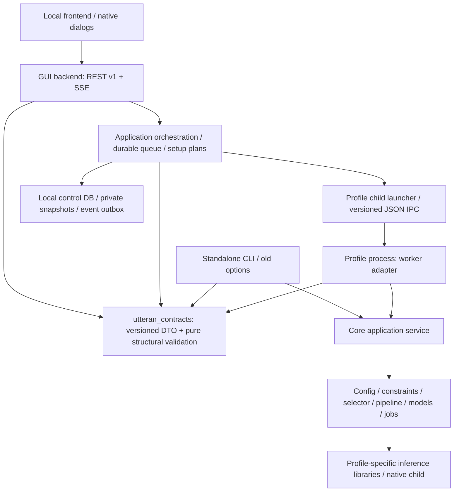

# ADR-002: 構造化実行契約とprofile process隔離

- Date: 2026-10-30
- Status: **Proposed — approval required**
- Scope: Phase A設計のみ。UIフレームワークの採択を含まない。
- Context: [監査](../architecture/phase-a/audit.md)、[契約](../architecture/phase-a/contracts.md)、[状態遷移](../architecture/phase-a/lifecycles.md)。

## 問題

GUIはcore非依存を守っているが、HTTP payload→GUI dataclass→CLI option→Configの変換が設定の拡張を制限する。profile定義や候補の制約が複数層へ分散し、GUIキュー・実行状態は再起動で消える。GUI-firstの通常操作とExpertの共通・個別設定を安定して支えるには、UI部品の交換より先に契約と状態の正本が必要である。

## 提案する依存方向

矢印は呼び出し・依存方向。GUI packageから `utteran` / torch / OpenVINO等へのimportは禁止を維持する。`utteran_contracts`はどちらのpackageもimportしない。DTOはPydantic等の軽量依存のみ、importにprobe・filesystem scan・process起動・model download等の副作用を持たせない。構造・enum・version検証のみ共通化し、model/backend/device互換性の意味検証はcoreから返す。`utteran_paths`の配置規約は維持する。

core application serviceはCLIに依存しない。独立CLIはHTTP serverなしで稼働する。HTTP APIはGUI process内にあり、推論はprofile childで行う。重いlibraryを持つ常駐serverへ全面置換しない。

## 決定案

1. **形の正本**: 版管理されたcontracts DTOとそこからビルド時出力するOpenAPI/JSON Schema。Phase Aでは[手書きOpenAPI案](../architecture/phase-a/openapi.yaml)をレビュー用基準とし、後続PRでDTO生成物と差分照合する。
2. **意味の正本**: core application service。CLI/workerで共通の設定正規化・対応構成・resume判定を使い、frontendへ同じルールを再実装しない。GUIは返却された制約・理由codeを表示する。
3. **要求の正本**: GUI backendのrevision付きPreset/Policyと、投入transactionで確定したJob Snapshot。core Configは互換adapterの実行表現として残す。CLI従来設定の優先順位をv1の投入後に再適用しない。
4. **プロセス境界**: profile-local workerへ標準入力でJSON envelope、標準出力でversion付きJSONL。stderrは保護済み診断専用。shell=False、固定executable、protocol handshake、request IDを使用。旧CLI adapterは移行中のみ残す。
5. **永続化**: control planeにSQLite transaction + outboxを第一推奨とする。単一desktop owner、単一実行slotから開始。DBは`utteran_paths`で解決するuser data/portable data内の新領域。旧core job manifestは書式維持。DBとcore fileを跨ぐ完全な一括transactionは主張せず、attempt IDと成果物照合で復旧する。
6. **実行確定**: validation結果を投機的に信用せず、投入時にrevision・inventory fingerprint・入力を再確認。immutable snapshotには解決済み設定、候補、許可fallback、根拠を保存。開始時の環境変化はblocked、再解決は新規job。
7. **セットアップ**: frontendの工程進行をbackendの承認済みplanへ移す。初回/追加profileは同じplan engineを使う。既存profileを無断で削除・再同期しない。journal永続化とprocessの再開を区別する。
8. **UI非依存**: 通常/Expert/環境管理の違いはprojectionとediting sessionで表現し、共通backendを使う。WebView2、OS dialog、session保護、オフラインasset同梱は維持する。

## 比較した代替案

| 案 | 利点 | 不採用・留保理由 |
|---|---|---|
| GUIからConfig/coreを直接import | 変換が短い | 推論依存と副作用、配布禁止条件を破るため不採用 |
| 現CLI optionの拡張だけ | 既存接続を再利用 | DTO/意味の多重化、Promptがprocess argvへ露出、版交渉・atomic batchを表せない。互換経路に限定 |
| 全profileを単一venvへ統合 | 配置が簡単 | torch build衝突、device runtime隔離を失うため不採用 |
| profileごとの常駐HTTP server | warm model再利用 | shutdown・認証・port・memory管理が増す。実測根拠なし、将来独立ADRへ留保 |
| メモリqueue + JSON fileだけ | 小規模 | reorder/idempotency/outboxの同時更新とcrash復旧が難しい。SQLite推奨だがportable安全性の実証後に採択 |
| UIだけで型/制約を所有 | 素早い表示 | CLIと乖離するため不採用 |

## セキュリティ・配布への影響

共有DTOはGUI専用venv/installerへ入れられる軽量wheelにする。`packaging/gui.spec`のcore・推論module禁止検査を維持し、contracts wheelのtransitive dependency/import graphを新しい受入項目にする。ビルド時だけNode/型生成が必要になっても、配布時にNode・CDN・schema serverを要求しない。

既存のloopback bind、session cookie/header、CSPは保持し、v1 mutationにはOrigin/Host・JSON content type検査を追加提案する。Prompt/用語集・input path・本文は通常log/SSEへ流さず、private local snapshotにのみ保存。token値はsnapshotにも保存せずkeyring/session参照とする。CLIの独立動作・旧core hash・portable session-only tokenは変更しない。

## PR #23との関係

ADR-001の状態整合性優先・段階移行・pywebview分離・local assetsは整合する。本提案はAPI/IPC、永続queue、setup orchestrationを先行し、UI-2でVue/PrimeVue導入を前提にしない。Vue 3/TS/Vite + PrimeVue、React/TS + MUI等はVM spike候補のまま。詳細比較と統合案は[監査](../architecture/phase-a/audit.md)。採択順は「Phase A契約レビュー→backend基盤→独立UI技術判断」。

## 採択前のゲート

共有DTOの配布境界、SQLite crash/portable test、worker版交渉、private snapshotの保護、setup planの承認粒度は[判断事項](../architecture/phase-a/review.md)をレビューする。採択後もGPU性能・Prompt有効性・hard cancel安全性を成功扱いにしない。
