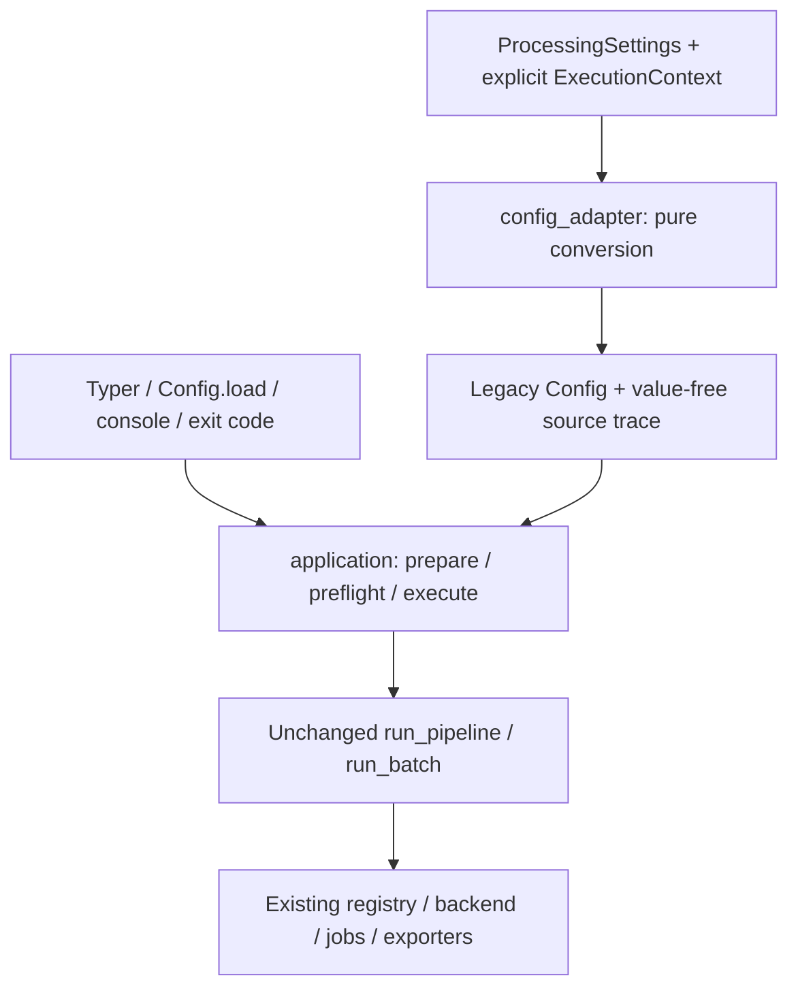

# Phase B2 — Core Application Service / Config Adapter

2026-10-30、レビュー待ち。製品version 0.1.31。**既存処理の入口整備であり、新API/UI/worker/ジョブ機能・永続queue・自動選択・データ移行は実装していない。**

開始main `1097aeffe9c8562aaf6b12f2e4a1bd37de8888b6`、Phase A `60d9bdd6006551149c6dde5a735dee17c16cc15d`、開始B1 `de67f185c3bd16eb631bf371ed853082375c0ca5`をfetchで確認。B1ゲート修正を`feat/b1-contracts`の独立commit `0f80d17`へpushし、Python3.11/3.12の契約52件成功を確認後に`feat/b2-core-application-service`を作成した。

## 責務・接続



- [`application.py`](../../../src/utteran/application.py): inputの種類・folder限定flag、既存ASR制約によるprepare、既存dependency preflight、型付きprogress/cancel/resume引数の受け渡し。戻り値は既存PipelineOutcome / BatchSummary、既存例外をラップせず伝播する。
- [`config_adapter.py`](../../../src/utteran/config_adapter.py): ProcessingSettingsと明示したcore-local ExecutionContextからConfigへ変換。副作用なし。core既定値/DTO/正規化の値を含まないsource trace、ConfigAdaptationError(ConfigurationError、exit 2)を提供する。
- CLI: 既存Config.load優先順位、logging初期化、token取得/登録、モデル取得承認、dry-run/empty表示、Rich/JSONL、Ctrl+C thread制御、終了コードを保持。path/filter検証・cheap preflight・single/batch呼出しだけをserviceへ委譲。
- Pipeline、batch algorithm、registry、JobStore/hash/manifest、ASR/diarization、exporter、GUI/packagingは変更しない。CLIのmodels/native/benchmark等を全面移植しない。

CLIからは従来のrun_pipeline/run_batch参照をrunner注入する。これは既存test/callerのpatch接続点を維持するためで、別の実行アルゴリズムではない。通常のcore利用ではrunner指定不要。

## core利用例（worker実装ではない）

```python
from pathlib import Path
from utteran.application import prepare_request, preflight_dependencies, execute_single
from utteran.config_adapter import adapt_settings

adapted = adapt_settings(processing_settings, explicit_context)
request = prepare_request(Path(input_path), adapted.config)
preflight_dependencies(request.config, token_provider)
outcome = execute_single(request.input_path, request.config,
                         token_provider=token_provider, progress=callback,
                         cancel=cancel_token, resume=True)
```

preflightは明示段階。dry-runやempty folderではCLI従来どおり省略できる。execute中の既存backend/pipeline検証は省略しない。serviceは勝手にモデルをdownload/承認しない。runtime ready判定は提供しない。

ExecutionContextはcore内dataclassで、B1に未実装のResolvedSpec/JobSnapshotではない。base_configは全legacy既定値を明示する入力（例Config.model_validate({})）。Config/ExecutionRequestは従来互換のmutable core設定を参照するため、実行中にcallerが変更してはいけない。投入後不変snapshotやプロセス境界はB3/B7の別責務。

## 実装範囲と参照

- [対応表・拒否・正規化](mapping.md)
- [Golden/hash/resume/出力互換性](compatibility.md)
- [検証と未検証](validation.md)
- [B1 lock/profile調査](../b1/profile-lock-impact.md)

GUI→core importは増やしていない。core→contractsの依存だけを追加。worker/API/SSE向けerror projection、IPC handshake、GenAI structured変換の拡張、選択engineやimmutable job snapshotを先取りしない。Ready化・merge・B3へ進まずレビュー待ちとする。
