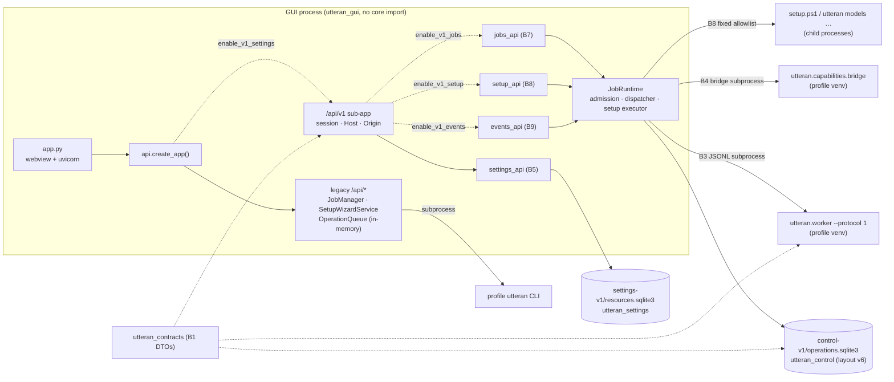

# Components — module responsibilities and boundaries

コード（`src/`、`main` `e803ecc3` + 本ブランチ）から逆引きした構成。存在しないモジュールは書かない。
**注:** 計画資料に出てくる`src/utteran_worker/`は存在しない。workerは`utteran.worker`／`utteran.worker_runtime`。

## パッケージと責務

| package | 主なmodule | 責務 | import境界（テストで強制） |
|---|---|---|---|
| `utteran_contracts`（B1） | `settings` `editing` `preview` `capabilities` `control` `jobs` `setup` `events` `worker*` `*_schema` | 公開/私的DTO、純粋なreducer・状態検証、offline JSON Schema生成 | `utteran`・`utteran_gui`・推論系を**importしない**（`tests/test_contracts_boundary.py`） |
| `utteran_paths` | `__init__` | 管理データの保存先を一箇所で解決（`UTTERAN_DATA_ROOT`等） | 依存なし |
| `utteran`（core） | `application`（B2）、`worker` / `worker_runtime`（B3）、`capabilities/*`（B4）、`cli` `pipeline` `asr/` `diarization/` 他 | 推論・出力・CLI。B3は1 request JSONL worker、B4はread-only inventoryとpure resolver | profile venv内で実行。GUIプロセスからはimportされない |
| `utteran_settings`（B5） | `repository` `inheritance` | Preset/Policy履歴SQLite（`settings-v1/resources.sqlite3`）、純粋な継承preview | contractsのみ |
| `utteran_control`（B6〜B9） | `store`(v1/v2) `job_repository`(v3) `setup_repository`(v4) `events_repository`(v5/v6) `recovery` `transitions` | 永続control store、transactional Outbox、冪等性replay、lease/fencing、recovery判定、sync/diagnostics | contractsのみ。HTTP・processを知らない |
| `utteran_gui` 既定経路 | `app` `api`(legacy routes) `cli` `jobs` `operation_queue` `setup_wizard` `history` `processes` `settings` | 旧GUI: loopback FastAPI＋webview、profile CLIのsubprocess実行、in-memory queue | core非import（subprocessのみ） |
| `utteran_gui` v1（opt-in） | `settings_api`(B5) `jobs_api` `job_admission` `job_dispatcher` `job_runtime` `process_verifier` `worker_client` `capability_inventory`/`capability_transport`(B7)、`setup_api` `setup_planner` `setup_executor`(B8)、`events_api`(B9) | `/api/v1` sub-app、Job/Setup受理・dispatch、SSE/sync/diagnostics | 遅延import。既定起動では読み込まれない（`test_b7_api.py::test_default_app_has_no_job_routes_store_or_heavy_imports`） |

## 依存と実行境界

- **単一heavy slot**: B7のJob dispatchとB8のSetup実行は同じ`JobDispatcher`・同じcontrol DBのleaseを共有し、
  同時に1つしか重い子プロセスを起動しない。
- **cutover**: `JobRuntime.activate()`は旧`OperationQueue`がidleのときだけ所有権token付きで閉じる。
  以降、旧queueと新queueが並行dispatchすることはない。`deactivate()`はactive attemptがあれば拒否。
- **B2 `utteran.application`** はcore内部のpresentation非依存層で、B3 workerが使う。GUIは直接呼ばない。

## 起動経路

1. **既定GUI**: `utteran_gui.app` → `create_app(session_key, repo_root=project_root())`。
   `/api/*`のみ。control DB・settings-v1 DBは作らない（`tests/test_backend_foundation_e2e.py`で確認）。
2. **B5のみ**: `create_app(..., enable_v1_settings=True, v1_authority="127.0.0.1:<port>")`。
3. **B7〜B9**: さらに`enable_v1_jobs` / `enable_v1_setup` / `enable_v1_events`。依存順の違反は
   `ValueError`（例: jobsなしのsetup/events）。runtimeを渡さなければ`_default_job_runtime()`が
   `resolve_data_paths()`のcontrol storeと本物のB4 bridge・B3 worker・`ProcessChildRunner`を組み立てる。
4. **CLI**: `utteran …`（profile venv）。v1 control storeとは無関係。

詳細: [B3 protocol](../b3/protocol.md)、[B4 resolution](../b4/resolution.md)、[B5 api](../b5/api.md)、
[B6 transactions](../b6/transactions.md)、[B7 dispatch-recovery](../b7/dispatch-recovery.md)、
[B8 execution-recovery](../b8/execution-recovery.md)、[B9 events-sse](../b9/events-sse.md)。
