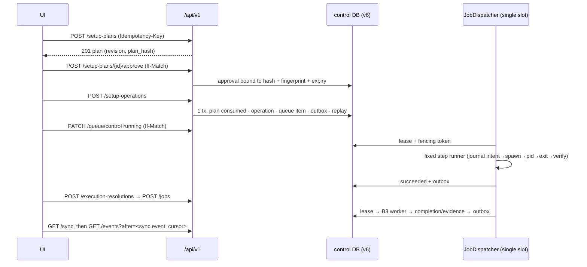

# Interfaces — enablement, current routes, DTOs and state machines

## 有効化条件（`utteran_gui.api.create_app`）

| 引数 | 追加されるもの | 前提 |
|---|---|---|
| （既定） | 旧`/api/*`、`/launch`、`/`、`/assets`、`/logo` | — |
| `enable_v1_settings=True`, `v1_authority="127.0.0.1:<port>"` | `/api/v1` sub-app（B5） | `v1_authority`必須（無いと`ValueError`） |
| `+ enable_v1_jobs=True` | B7 routes。`JobRuntime.activate()`で旧queueを閉じる | settings必須 |
| `+ enable_v1_setup=True` | B8 routes。runtimeはlayout v6の`ManagedControlStore` | jobs必須・runtimeに`setup`部品 |
| `+ enable_v1_events=True`（`v1_events_config`任意） | B9 routes | jobs必須 |

`/api/v1/*`は旧`/api/*`のsession middlewareを通らず、v1 sub-app自身が**session（header `x-utteran-session`
またはcookie `utteran_gui_session`）・Host（=`v1_authority`）・Origin**を検証する。書込みは`Origin`か session headerが必要（CSRF）。
失敗は`401 session_required` / `403 host_rejected` / `403 origin_rejected` / `403 origin_required`。

## 現行endpointインデックス（実route、2026-11-03）

既定 `create_app()` のroute（golden固定は`tests/test_b9_events.py`ほか）:
`/api/health` `/api/version` `/api/environment` `/api/queue` `/api/queue/{id}/cancel` `/api/settings`
`/api/token` `/api/wizard/*` `/api/models/actions` `/api/jobs*` `/api/history*` `/api/open-folder`。

opt-in `/api/v1`（全部有効時）:

| Phase | method | path | 要求header |
|---|---|---|---|
| B5 | GET, POST | `/presets`、`/execution-policies` | POST: Idempotency-Key |
| B5 | GET, PUT, DELETE | `/presets/{id}`、`/execution-policies/{id}` | PUT/DELETE: If-Match |
| B5 | POST | `/validations` | — |
| B7 | POST | `/execution-resolutions` | Idempotency-Key（201、短命HMAC token） |
| B7 | GET, POST | `/jobs` | POST: Idempotency-Key（202、batch all-or-nothing） |
| B7 | GET | `/jobs/{job_id}` | ETag=revision |
| B7 | POST | `/jobs/{job_id}/{cancel\|retry\|rerun\|revalidate}` | Idempotency-Key + If-Match |
| B7 | GET | `/queue` | ETag=queue revision |
| B7 | PUT | `/queue/order` | Idempotency-Key + If-Match（CAS） |
| B7 | PATCH | `/queue/control`、`/queue/items/{item_id}` | Idempotency-Key + If-Match |
| B8 | POST | `/setup-plans` | Idempotency-Key（read-only plan） |
| B8 | GET, DELETE | `/setup-plans/{plan_id}` | DELETE: If-Match |
| B8 | POST | `/setup-plans/{plan_id}/approve` | Idempotency-Key + If-Match |
| B8 | GET, POST | `/setup-operations` | POST: Idempotency-Key（202） |
| B8 | GET | `/setup-operations/{operation_id}` | — |
| B8 | POST | `/setup-operations/{operation_id}/{retry\|resume\|cancel}` | Idempotency-Key + If-Match |
| B9 | GET | `/events` | `after=` または `Last-Event-ID`（SSE） |
| B9 | GET | `/sync` | `cursor` / `snapshot_token` / `limit≤999` |
| B9 | GET | `/jobs/{id}/diagnostics`、`/setup-operations/{id}/diagnostics` | `cursor` |

詳細な要求/応答・エラーコード表: [B5 api](../b5/api.md)、[B7 queue-and-transaction](../b7/queue-and-transaction.md)、
[B8 api](../b8/api.md)、[B9 events-sse](../b9/events-sse.md)・[sync](../b9/sync.md)。
Idempotency-Keyは16〜128文字のvisible ASCII。同key・異bodyは`409 idempotency_conflict`。

## DTOの正本

`src/utteran_contracts/`（B1 `settings`/`editing`、B5 `preview`、B4 `capabilities`、B6 `control`、
B7 `jobs`、B8 `setup`、B9 `events`、B3 `worker`）。公開projectionはallowlistで、private payload（prompt・path）
を含まない。schema bytesはCIで`--check`（[testing-and-operations.md](testing-and-operations.md)）。

## 呼出しシーケンス（Setup → Job、同一runtime）

## 状態遷移（要約）

`OperationStatus`: `queued` `held` `blocked` `running` `waiting_user` `cancelling` `succeeded` `failed`
`cancelled` `interrupted`。kind別の許可遷移は`utteran_control/transitions.py`（正本は
[phase-a/lifecycles.md](../phase-a/lifecycles.md)）。

| 対象 | 要点 | 詳細 |
|---|---|---|
| Job | 不変snapshot。dispatch前にprestart再検証、未検証構成は`blocked`。cancelは協調のみ | [B7 job-snapshot](../b7/job-snapshot.md) |
| Queue | `dispatch: running\|paused`、全変更はqueue revisionのCAS。activate直後はpaused | [B7 queue](../b7/queue-and-transaction.md) |
| Setup Plan / Approval | plan hash・観測fingerprint・期限・同意IDに束縛。環境が変われば`inventory_stale` | [B8 contracts](../b8/contracts.md) |
| Setup Operation | 工程DAG、step journal、検証できない成功は記録しない | [B8 execution-recovery](../b8/execution-recovery.md) |
| Outbox / SSE | commit済み行のみ、ID=`epoch:seq`単調。期限切れcursorは410 / `resync_required` | [B6 outbox](../b6/outbox.md)、[B9](../b9/events-sse.md) |
| Lease / fencing | 単一heavy slot、fencing tokenの古い書込みは拒否。確認できないownerは`recovery_required` | [B6 recovery](../b6/recovery.md) |

## Phase A OpenAPIとの差異

[phase-a/openapi.yaml](../phase-a/openapi.yaml)は2026-10-30の**提案**であり、現行実装の正本ではない。
2026-11-03時点の差異（route単位）:

| Phase A提案 | 現行実装 | UI実装時の注意 |
|---|---|---|
| `GET /capabilities`、`GET /environments[/{id}]` | **未実装** | 能力・環境一覧画面はB4 bridgeの公開APIが出るまで作れない |
| `POST/GET /environment-refreshes[/{id}]` | **未実装**（store上の`refresh_operation` kindのみ） | refresh UIは未対応 |
| 上記以外のPhase A path | 実装あり | 応答DTOは`utteran_contracts`を正とする（Phase AのschemaとField名・制約が異なり得る） |
| — | `GET /jobs/{id}/diagnostics`に加え`GET /setup-operations/{id}/diagnostics`を**追加** | |
| SSEのイベント種別 | `state_changed` `queue_changed` `resync_required`のみ。progress等は**配信しない** | 進捗表示は別途設計が必要 |

巨大なOpenAPIの自動生成・既存API仕様の全面変更は本作業では行っていない。
