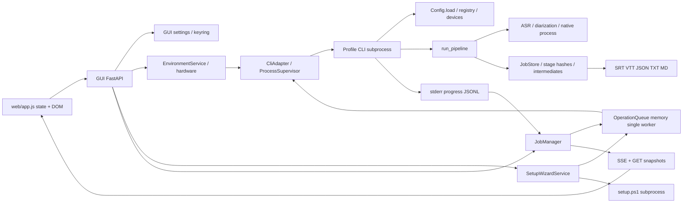

# 現行アーキテクチャ監査

対象は[調査main](README.md)のコード。**F=コード/取得資料で確認、H=設計上の仮説・改善提案、U=未検証**。過去のAISTATE実機記録は履歴であり、今回の実行証跡ではない。

## 現行データフロー（F）

## モジュール責務・依存と証拠

各リンクのsymbolで確認した。行番号は今後移動し得るためsymbolも併記する。

| 層・module | 確認した責務・状態 | 注意点 |
|---|---|---|
| [`utteran/cli.py`](../../../src/utteran/cli.py) `transcribe` | Typer入力、Config override、input/batch、progress、error/exit | API契約から直接呼ぶservice境界にはまだなっていない |
| [`config.py`](../../../src/utteran/config.py) `Config.load` | CLI > env > .env > TOML > default、nested merge、Pydantic | token様キー除外。現行はProfile/Preset/Policyの独立versioned storeではない |
| [`types.py`](../../../src/utteran/types.py) | ASROptions、result、progress、CancelToken | core package内。GUI共有DTOとして直接importする案は不可 |
| [`pipeline.py`](../../../src/utteran/pipeline.py) `run_pipeline`, `_asr_options` | normalize→ASR→diarize→merge→export、pool、memory guard | backend判定とstage再利用の正本。実推論は今回未実施 |
| [`jobs.py`](../../../src/utteran/jobs.py) `JobStore`, `Job.reconcile`, `stage_config_hashes` | input hash由来job ID、manifest、stage hash、atomic JSON、lock | GUI UUIDとは別。ASR hashはasr設定全体とpolicy versionを含む |
| [`devices.py`](../../../src/utteran/devices.py) `detect_devices`, `_auto_selection` | 隔離probe、cache、device/compute選択、DLL診断 | 自動選択は現行heuristic。全profile横断の新Policy契約ではない |
| [`native.py`](../../../src/utteran/native.py) | pinned whisper.cpp v1.9.2 + timeline patch、CMake、OS別manifest | buildはprofile横断共有、runtime library pathは実行venvから解決 |
| [`asr/registry.py`](../../../src/utteran/asr/registry.py) | faster-whisper / whisper-cpp / openvino-genai生成、GenAI言語制約 | GenAI + diarizationでauto/非スペース言語を拒否。GUIで解除してはならない |
| [`profiles.py`](../../../src/utteran/profiles.py) | cpu/cuda/intel/vulkan extras、OS別venv、default解決 | 発見とpath解決。venv構築自体はしない |
| [`utteran_gui/api.py`](../../../src/utteran_gui/api.py) `create_app` | local REST、payload検証、SSE、session保護 | OpenAPI公開無効、応答の多くはdict/object。統一error/versionは未整備 |
| [`gui/cli.py`](../../../src/utteran_gui/cli.py) `CliAdapter` | profile path・manifest鮮度、shell-free argv、JSON/text取得 | profile/extrasがcoreと重複。GUIの推論import回避を保持すべき |
| [`gui/jobs.py`](../../../src/utteran_gui/jobs.py) `JobManager` | UUID、子process、JSONL、raw log、cancel、snapshot | `_jobs`はメモリ。投入時argv作成、cancel要求時のexit codeは130へ変換 |
| [`operation_queue.py`](../../../src/utteran_gui/operation_queue.py) | 1 worker、Condition/RLock、waiting順序、cancel | 順序変更・hold・dispatch pause・disk復元なし。runner/canceller callableは永続化不可 |
| [`environment.py`](../../../src/utteran_gui/environment.py) | profile CLI JSON集約、installed models、native、derive_options | devices probe timeout=200秒。候補生成にcore制約との重複がある |
| [`hardware.py`](../../../src/utteran_gui/hardware.py) | GPU/RAM/disk/runtime probes、profile推薦 | vendor表示だけでなくruntime不明を区別。初回環境なしのbootstrap要件がある |
| [`setup_wizard.py`](../../../src/utteran_gui/setup_wizard.py) | venv/model/native/smoke child、stage記録、complete guard | Windows venv buildはsetup.ps1。operation objectはメモリ、step/completed stagesはsettings |
| [`settings.py`](../../../src/utteran_gui/settings.py) | GUI preference、wizard選択/工程、atomic保存、keyring | portableはsession-only token。processing presetとは未分離 |
| [`web/app.js`](../../../src/utteran_gui/web/app.js) | mutable state、DOM、api、EventSource、polling、wizardRunUnattended | 工程順序の判断がfrontendにある。APIにないstateを補う拡大は避ける |
| [`gui/app.py`](../../../src/utteran_gui/app.py), [`processes.py`](../../../src/utteran_gui/processes.py) | loopback socket、WebView2、dialog/D&D、child supervisor、終了 | standalone API server外部公開やElectronへの変更は不要 |

## 現API・CLI・設定の対応（F）

| 項目 | GUI REST / DTO | profile CLI | core設定・実行 |
|---|---|---|---|
| backend/model/device | POST `/api/jobs` `asr_*`, `profile` | `--asr-backend`, `--asr-model`, `--asr-device` | `Config.asr`→registry / backend.load |
| 言語 | `language` string | `--language` | `asr.language` nullable（内部ではauto相当もあり） |
| 話者分離/人数 | `diarization_*`, `*_speakers` | `--no-diarization`, `--diarization-*`, `--*-speakers` | `DiarizationConfig` + count validator |
| 出力 | `formats`, `output_dir` | `--format`, `--output-dir` | `output`, `general.output_dir` |
| 再処理 | `resume_mode` | resume / `--no-resume` / `--force` | stage hash + artifacts validity |
| batch | `recursive`, `include`, `exclude` | `--recursive`, `--include`, `--exclude` | batch→pipeline、同一backend pool再利用 |
| Prompt | **payload/optionsに項目なし** | **通常transcribe専用optionなし**、`--config`/env経由は可 | `ASRConfig.initial_prompt`→`_asr_options`→`ASROptions.initial_prompt` |
| VAD/beam/詳細 | payloadに一般経路なし | `--config`等で設定 | `asr.vad_filter`, `beam_size`, `whisper_cpp.*` |
| 温度 | payloadに経路なし | `--config`でwhisper_cpp設定 | `WhisperCppConfig.temperature`等。全backend共通温度とは断定しない |
| 話者表示名・再出力 | POST history export `speaker_labels` | `jobs export --speaker-label` | presentation/mergedからexportのみ |
| profile構築 | POST `/api/wizard/jobs` venv_build | PowerShell `setup.ps1 -Profile ... -Yes` | uv extras/profile manifest |
| model/native | `/api/models/actions`, wizard native_build | models download/remove/verify/prepare-openvino, native build | catalog/manager/native |
| 自動判定 | `/api/environment`, wizard hardware | devices --json、backend/device auto | devices/core + GUI側推薦/候補加工 |
| 設定 | GET/PUT/PATCH `/api/settings` | config init/show等 | GuiSettingsとConfigは別。processing preset APIはまだない |

現行HTTPの全routeはapi.pyのdecorator、CLIはTyper commandを正とする。主要領域にはhealth/version、environment、queue一覧/cancel、settings、token、wizard status/start/state/hardware/preflight/jobs/events/complete、models actions、jobs start/get/cancel/events、history list/detail/delete/export、open-folderがある。新設計の`/api/v1/*`は現存しない。

## Prompt監査（F / U）

- F: faster-whisper `transcribe(initial_prompt=...)`へ渡る。whisper.cpp `build_command()`は`--prompt`を付ける。GenAIはgenerationの`initial_prompt`へ渡す。
- F: whisper.cpp既定`no_context=true`は`--max-context 0`へ変換される。Prompt専用の利用可能性判定・用語集compiler・共通自由引数契約はない。
- F: ASR stage hashは`config.asr.model_dump(mode="json")`を含み、Prompt設定変更はASR hashへ影響する。これだけで認識品質改善が実証されたとは言えない。
- U: `--max-context 0 + --prompt`の実効性、carry-initial-promptと反復抑制の両立、GenAIのモデル別Prompt挙動は実モデルA/B未実施。Issue #1を独立受入に残す。単純なno_context=falseへの変更は提案しない。
- H: 新workerはPromptをargvへ渡さずprivate stdinに載せる。ただしwhisper.cpp自身の`--prompt`に残るOS process情報露出は別途対処が必要。標準入力対応/保護された入力経路のspikeが成功するまで「全backendでargv漏洩解消済み」としない。

## 状態・同期・security（F）

- OperationQueue statusは`waiting/running/completed/failed/cancelled`。GuiJobは`starting/running/completed/failed/cancelled`。core manifestはstage別`pending/running/done/failed`等。ID/状態は同義ではない。
- core job manifest、中間schema、presentationはversion検証を持つ。新API schema versionとは別に扱う。
- SSE handlerは接続ごとに`cursor=0`、配列index由来`id`を送信する。`Last-Event-ID`を読み取らないため、新契約のdurable cursor replayを満たしていない。
- GUI終了時はjobs/wizard/supervisorをshutdownし、子processを停止する。settingsのcompleted_stagesが残っても、停止したnative処理をinstruction pointerから再開できない。
- `openapi_url=None`、docs/redoc無効。`/api/`はheader/cookie session認証、cookie HttpOnly/SameSite=strict、CSP self、no-store、nosniff、no-referrer。loopback bindはapp.py。Origin/Host検査を新契約で明確化する（現行で網羅的に実装済みとは主張しない）。

## 技術的負債（H、根拠は上記F）

1. Profile名/extras・payload・dataclass・CLI option・Configの重複。形の共有とcore意味検証を分離する。
2. GUIの候補加工とcoreの禁止条件に乖離余地。構成catalogをcoreが出力し、installedとsmoke verifiedを分離する。
3. メモリqueue/UUIDとdisk core jobの対応が弱い。attemptとcore job IDの明示link、durable control storeが必要。
4. frontendの工程進行、polling/SSE/POSTの更新競合。APIにrevision・idempotency・event replayを追加する。
5. raw child outputや例外からの診断漏洩余地。既存maskを保持した上で、v1は許可fieldのdiagnostic projectionを標準にする。

無反応/更新漏れのユーザー報告について、今回Windows上では再現していない。コード規模だけで因果関係を断定しない。

## IssueとPR #23の照合

指定IssueのbodyをGitHub Web埋め込みJSONから2026-10-30に取得。#1/#6/#12/#17/#18/#20/#21/#22は取得時コメント0、#19は1件の表示あり。#19コメントの全文・PR discussion/CIは今回未取得であり、bodyとPR branch上のADRを比較対象とした。

| 対象 | 既存方針 | Phase Aでの扱い |
|---|---|---|
| #17/#18 | GUI-first、core正本、段階移行、Issue正本 | 維持。設計でIssueをcloseしない |
| #19 / PR #23 | ADR-001、isolated JS stale response再現を報告 | PRの報告として参照。今回そのPlaywright再現は再実行していない |
| #20 | typed client、state、非同期信頼性 | backend契約/IPC基盤を先行する依存へ整理 |
| #21 | 画面移行、既存機能保持 | 通常/Expert共通契約と機能parity表へ落とす |
| #22 | VM/mockと対象実機を分離 | acceptance表で実施環境と合格条件を区別 |
| #1 | 内部Prompt配線あり、CLI/GUI導線不足、context問題 | typed setting/機密保護は設計、品質実測は後続 |
| #6 | 用途中心の推薦、backend制約重複禁止 | 構成catalog + Policy +理由/evidence、未承認install禁止 |
| #12 | GenAI cancel latency、hard kill検討 | cancellingと終了確認を分離、hard cancelは未保証 |

PR #23はADR-001だけの差分（head SHAはREADME参照）。Vue3/TS/Vite・PrimeVueを第一候補とし、UI-2でspike/導入する案。本Phase Aはframework未決定を維持し、API/IPC/永続stateを先にレビューする点が異なる。pywebview継続、local assets、stale対策、段階切替・rollbackは統合可能。統合するなら両ADRのリンクとUI-2前提順の文書修正を別レビューで行う。PR #23へ無断push/取り込みはしない。

## 関連テスト・保持すべき資産

`test_cli/config/pipeline/jobs/exporters`はCLI・設定・hash/resume・出力、`test_asr_registry/faster_whisper/whisper_cpp/openvino_genai`はbackend制約、`test_devices/native/profiles`は環境、`test_gui/gui_processes/setup_wizard/operation_queue`はGUI境界・security・子process・queue、`test_data_paths`はportable配置を検証する。これらの存在は実機動作保証ではない。新契約の受入は[migration](migration.md)で追加する。
