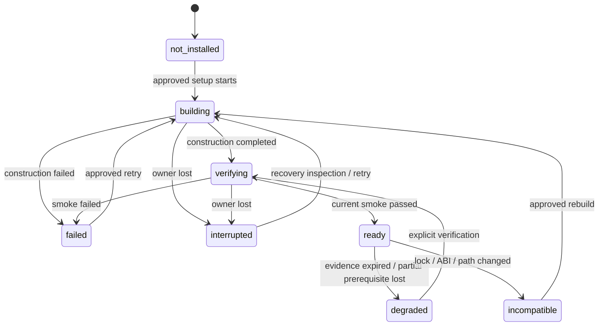
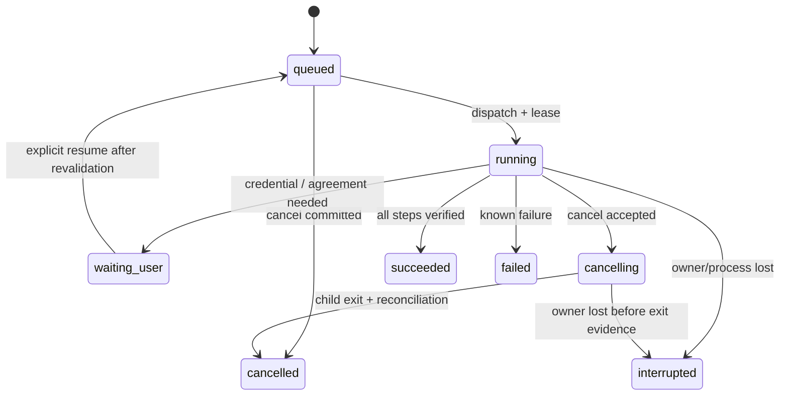
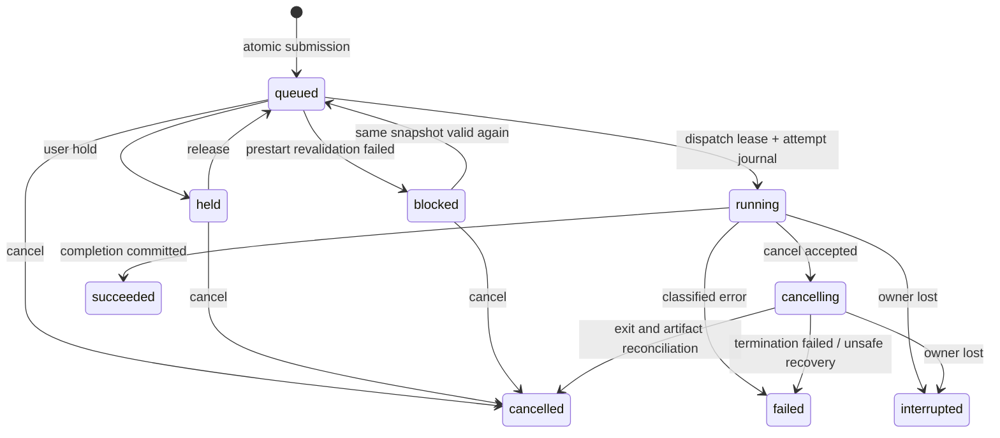

# 状態遷移・ライフサイクル案

全stateはbackendで保持しAPIへ返す。UIのspinner/通信reconnectingはtransport stateであり、jobの実行状態を推測して上書きしない。以下にない遷移は409 `invalid_transition`。終端からの再実行は元resourceを巻き戻さず、新resource/attemptを作る。

## 1. Environmentと実行可能性

環境stateはvenv generation全体の摘要。native/modelごとのObservationは独立。ready環境でmodelが欠ければそのcandidateはblocked。ドライバー検出unknown/未smokeはcandidate unknownで、readyへ昇格禁止。incompatible→readyの直接遷移、ファイル存在だけでnot_installed→ready、failedをUIがready扱いすることは禁止。既存環境発見時はdegraded/unknown evidenceからverifyする。再buildは別generationを準備・検証しatomic pointer切替を推奨、旧generationはlease中削除不可。Windows venvの移動可否を検証せずrename promotionはしない（固定最終pathで構築する代案はreview参照）。

## 2. Setup PlanとSetup Operation

Plan: `proposed → approved → consumed`。`proposed/approved → expired`（期限/変更）。approveはhashとinventory revisionが一致した場合だけ。consumedから別operation作成は409、同key replayは同operation。計画のcancel/deleteは未消費のみ。approved後の編集は新plan。

waiting_userは失敗を隠す状態ではなく、missing requirementをreason_codeで返す。retryable failure→新SetupOperation（retry_of）。interrupted/waiting_userのresumeは同logical operationへ新attemptを追加してqueuedへ、planの変更が要れば409 `reapproval_required`。succeeded→running、cancelled→runningの直接遷移は不可。

工程state: `pending/running/succeeded/failed/interrupted/skipped`。skippedはnot_requiredかvalidated_reuseの理由必須で成功の捏造に使わない。step start前にjournal persist、completion evidenceを書いてからsucceeded。operation終了は全required stepの検証済み成功が必要。GUIの保存済みcompleted_stagesをv1でそのまま信用しない。

### 初回CUDA→追加IntelのAPI/状態例

| 段階 | API | 遷移・必須条件 |
|---|---|---|
| NVIDIA発見 | POST environment-refreshes / GET environments | refresh running→succeeded。hardware観測とCUDA runtime可否は別 |
| CUDA推薦と計画 | POST setup-plans（profile_kind=cuda） | proposed。venv/model/native変更と容量・同意要件を表示 |
| ユーザー確認 | POST plans/{id}/approve | approved、plan hash/If-Match一致 |
| CUDA構築 | POST setup-operations | consumed、queued→running→venv/model/native/verify/smoke→succeeded |
| 登録 | GET capabilities | smoke fingerprint一致candidateのみready、inventory revision更新 |
| Intel追加 | 同じsetup-plans API、profile_kind=intel | existing CUDA保持をchangesに記載。Intel model/venvだけ承認対象 |
| Intel検証 | approve→setup-operations | CUDA環境削除なし。shared native資源はlease、更新は承認範囲のみ |
| 再評価 | POST execution-resolutions | 新inventoryからauto候補を再rank。根拠なければ性能優位を断定しない |
| 既存job | GET jobs/{id} | snapshot不変。次回投入だけ新selectionを使用 |

### 再開分類

| 工程 | 再起動後の検査 | 許す回復 | 禁止する仮定 |
|---|---|---|---|
| hardware/inventory | 現runtime fingerprint | probe再実行 | 古い観測をcurrent扱い |
| venv sync | interpreter、lock/extras、package整合 | 同じpinned planのsync再実行、壊れた新generationのみ再作成 | uv process内部位置からresume |
| model download | manifest、checksum、partial情報 | managerが対応するrange/cache再取得→完全検証 | partial fileをinstalled扱い |
| native build | source commit/patch、toolchain/CMake flags、manifest | 対応build cacheのみ再利用してbuild再実行 | compiler processの途中再開 |
| IR生成 | model hash、shape/precision、完全出力 | 完成済みverified reuse、不完全なら再生成 | 途中IRを利用 |
| smoke | exact model/route/runtime fingerprint | synthetic smokeを再実行 | 過去の別環境smokeで代用 |
| token preflight | session/keyringのpresence、現在のgatedアクセス | 再認証/再検査 | token/同意の永続成功扱い |
| 最終登録 | 全step evidence、generation pointer | idempotent catalog更新 | exit codeだけでready |

## 3. ジョブとattempt

`blocked`はsnapshotのprofile/model資源が一時利用不可。snapshotのfingerprintと同じ資源が戻ったと検証できた場合のみrelease可能。別generation/auto再解決が必要なら新jobを作る。`held`は利用者意思、`blocked`は実行条件不足、両方のreasonは別metadataで保持し、releaseはblockを解除しない。

retryはfailed/interrupted/cancelledから新job（retry_of、同snapshotのprivate settingsを複製、入力/資源を再検査）、rerunはterminalから新job（rerun_of、新resolutionを要求）。元のsnapshot/terminalを変更しない。retryで入力identity不一致は409、現在のpresetを勝手に適用しない。既存core job IDはinput由来なので、同一入力の複数GUI jobが同core lockを取り合う。初期実装は単一slotに加えcore lockを必須とし、retryも別attempt IDを付ける。

core resumeはstage単位。hash/evidence/artifactが一致した完了stageだけ再利用する。途中ASR/native callは再実行。変更されたPrompt/extra args/model revisionでASR以降を無効化する。postprocessing変更はmerge以降、output変更はexportのみ。既存hash algorithmは移行PRで回帰固定し、control snapshot hashを旧stage hashへ直接代入しない。

### cancel/complete競合

同resource revisionに対しbackend transactionで直列化する。

- completion commitが先: succeeded/failedは終端。cancelは最新GET後の要求なら200（terminal snapshot、no-op）、古いIf-Matchは412。完了をcancelledへ書き換えない。
- cancel commitが先: cancellingへ移行。childがexit 0を返してもcancelledで収束、completed outputsはreconciled partial artifactとして記録し通常成功一覧へ混ぜない。
- cancelは202の要求受理であり停止完了ではない。実process退出とlock/artifact照合後にcancelled。queue slot/leaseは停止確認まで解放しない。
- cooperative cancelとforce killはcapabilityを分ける。interruptibility=`cooperative/delayed/process_boundary_only/unknown`、latency estimate nullable。GenAIのnative処理中は待ちを表示、hard killはresume/cacheの受入後のみ対応。UIに実行一時停止を表示しない。

## 4. キュー

Queue dispatch: `running ↔ paused`。pausedは**新しいdispatchを止めるだけ**。実行中の推論・setupは継続する。active process suspend/resumeは全backend未サポートとして初期capabilityでfalse。OS process suspendを安全なpauseと見なさない。

itemはresource kind/id、position、hold、blocked reasonsを持ち、job/setup固有stateは元resourceを正本にする。hold/releaseはwaitingだけ。order PUTはactive/terminalを除く全待機IDの**完全な順列**、heldも含む。欠落/重複/外部IDは422、revision競合は412、dispatch済み混入は409。Queue revisionとresource状態の変更は同transactionで行い、dispatcherも同lock/DB transactionを使う。slotは1、held/blockedをskipして最初のeligibleを取る。setup retryはtailへ。性能の優先順位や複数GPU並列は別ADR。

## 5. 再接続・process終了・復旧

- frontendだけの再接続: backendは実行継続。sync snapshot+event cursorで復元。
- GUI process正常終了: dispatchを止め、終了intentをjournal化し、子processをcancel/停止。停止確認前に成功・slot解放を記録しない。待機jobは保持し次起動時held、setupはexplicit resumeが必要。
- crash/電源断: OS supervisorの境界でchild退出を確認。起動時DB owner leaseとprocess identity（PIDだけでなくstart time/nonce）を照合し、実行中recordをinterruptedへ。PID存在だけで自分のworkerと認定しない。
- child生存不明時はrecovery_required blockerを返し、二重workerを起動しない。旧core job lockの検査はcoreに任せる。
- 新起動ではqueue paused、待機resourceはheld（元の順番は維持）。明示再開でdispatch。setup途中やmodel downloadを自動的に続行しない。
- journal永続化は「どこまで成功したか」を復元する仕組み。停止した推論・uv・compilerをその命令位置から動かす仕組みではない。

## 6. 選択・fallbackの状態

selectionは`unresolved → validating → resolved|rejected → frozen`。resolved期限/入力/inventory変更でstale、新しいresolveへ。frozenはjob snapshot内でimmutable。実行の観測は`attempt_started → initialized|initialization_failed → completed|failed`。失敗時preapproved fallbackがあれば別attempt、なければterminal失敗。from/to/reason/実route観測はattempt記録へ、policyやsnapshotを書き換えない。
