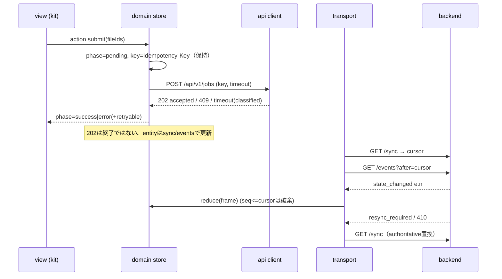

# UI-1 次期frontendアーキテクチャ・段階移行・rollback

更新: 2026-11-04 JST。**UI-2が迷わず着手するための設計案**（採択前）。framework/kitは
[ADR-003](../../adr/ADR-003-ui-frontend-stack-and-host-boundary.md)の推奨（Vue 3 + Vuetify）を前提に書くが、
コア層はframework非依存なのでReact + MUI案でも同じ構成になる。

## 1. 層と責務

| 層 | 責務 | 持たないもの |
|---|---|---|
| `host/` host bridge | `pickPath(kind)`、`onDroppedPaths(cb)`、`reportError(payload)`、`openFolder`。実装は`pywebview`（`window.pywebview.api`＋`utteran-input-dropped`）と、テスト用`fake`。将来`electron`を追加 | UI、API通信 |
| `api/` API client | `fetch`ラッパ: timeout（AbortSignal）、request ID、エラー分類（`validation`/`conflict`/`not_found`/`unauthorized`/`unavailable`/`timeout`/`network`/`server`、`retryable`）、Idempotency-Key・If-Match付与。**unsafe methodは自動再送しない**（同じkeyでの明示再試行のみ） | 状態、描画 |
| `transport/` SSE＋sync | v1: `/sync`→`/events?after=cursor`。`epoch:seq`の単調性検査、重複・逆順の破棄、410/`resync_required`で`/sync`再取得、keepalive監視、再接続backoff、可視状態（`connected`/`resyncing`/`offline`）。旧API用: 単一in-flight polling | 業務判断 |
| `domain/` 状態・query cache | 画面横断の正本（入力リスト、共通default、override draft、jobs/queue/setupのentity cache、環境）。GETはlatest-wins（世代番号＋Abort）。操作ごとの`phase`（`idle/pending/success/error`）とretry。純粋reducerで単体テスト | DOM、kit |
| `features/<画面>/` view | Vue SFC（またはReact component）。kit標準部品で構成し、`domain`のselectorとactionだけを使う | fetch直呼び、`window.pywebview`参照 |
| `i18n/` | ja/en辞書、v1 error code→文言、日時・サイズ書式 | — |
| `styles/` theme | kit theme（密度compact、落ち着いた配色、light/dark/system）、レイアウトtoken | 画面固有の装飾 |
| `test/fixtures` | 合成DTO（`utteran_contracts`のschemaから生成または検証）、fake backend、fake clock | 実データ |

**coreの意味検証（互換表、ready判定、Preset検証）はfrontendに複製しない。** frontendが持つのは
「表示・入力の形式検査」と「操作の状態遷移」だけ。

### ディレクトリ案

```text
frontend/                 # 新設（Node/Viteのproject。node_modulesはcommitしない）
  package.json  package-lock.json  vite.config.ts  tsconfig.json
  src/
    host/{index.ts,pywebview.ts,fake.ts}
    api/{client.ts,errors.ts,legacy.ts,v1.ts}
    transport/{events.ts,sync.ts,poller.ts}
    domain/{store.ts,environment.ts,inputs.ts,settings.ts,jobs.ts,queue.ts,reducer.ts}
    features/{workspace,results,models,queue,setup,settings}/...
    i18n/{ja.ts,en.ts,codes.ts}
    styles/theme.ts
  test/{unit,e2e,fixtures}
src/utteran_gui/web-next/ # build成果物（CIでbuildしてwheel/installerへ同梱。commit方針はUI-2で決定）
```

## 2. データフロー



## 3. 競合対策（UI-1欠陥との対応）

| 対策 | 実装位置 | 防ぐもの |
|---|---|---|
| GETの世代番号＋前リクエストのAbort、後着破棄 | `domain`（スパイク`loadEnvironment`） | D-01、R-04 |
| 操作ごとの`phase`、pending中のdisabled＋spinner、失敗の領域内表示とretry | `domain`＋view | D-02、D-05、D-06、R-09 |
| entityはID keyed cache。終了遷移は`revision`比較で単調、job IDを照合 | `domain/jobs` | D-03、D-04 |
| 単一in-flight polling（前回完了後に次をschedule）、失敗は接続状態に表示 | `transport/poller` | D-07、R-03 |
| `epoch:seq` reducer、重複/逆順破棄、410/`resync_required`→`/sync` | `transport`＋純粋reducer | D-08、G-04 |
| Idempotency-Keyは「操作の意図」単位で生成し、再試行で再利用 | `api`＋`domain` | 二重投入 |
| timeoutは操作別（GET 15s、環境probeは長いので進捗表示＋中止、POST 30s）※値はUI-2で決定 | `api` | R-01 |
| 202/acceptedとterminalを区別。POSTの応答喪失はsyncで照合（失敗と断定しない） | `domain` | 「通信失敗＝処理失敗」の誤表示 |
| dialogはキットのDialog（queue化）。確認dialogは同時に1つ、重なりは待機 | view | R-05 |

**TODO（理由付き未確定）**: v1 error codeの網羅的なretryable分類（B5/B7/B8各codeの意味を契約から表に起こす必要）、
timeout値（WebView2実機の環境probe時間を測るまで決められない）、progressの扱い（G-03の契約次第）。

## 4. 段階移行

旧`app.js`を一括で書き換えない。**画面単位**で新frontendへ移し、旧UIへの入口を残す。

| 段階 | 内容 | 使うAPI | 完了条件 |
|---|---|---|---|
| S0 | `frontend/`雛形、host bridge、API client、domain store、i18n、theme、Vitest/Playwright、CI job、新資産の配信route（G-12）とCSP nonce（G-11）。新UIは**opt-in flag**でのみ表示 | — | 旧UI既定のまま、flagで空の新shellが起動 |
| S1 | 設定画面 | 旧`/api/settings` `/api/token` | 旧設定画面と同等。保存失敗が見える |
| S2 | 環境表示・profile選択・再検出 | 旧`/api/environment` | D-01が新UIで再現しない（ハーネス相当のE2E） |
| S3 | 文字起こし（通常＋Expertの入力/Inspector/投入/進捗/結果）、キュー表示 | 旧`/api/jobs*` `/api/queue`（単一in-flight poll） | D-03/D-04/D-06/D-07が再現しない。旧機能（batch glob、resume、話者数、形式）の欠落なし |
| S4 | モデル管理、結果・履歴・viewer、旧wizard | 旧API | 旧UIと機能表で同等（[ux-structure §8](ux-structure.md#8-旧画面--新画面-対応表機能欠落の管理)） |
| S5 | v1接続（Preset/Policy、Job/Queue CAS、Setup B8、events/sync） | `/api/v1`（opt-in） | G-01/G-04/G-07/G-08の受入後。旧queueとの排他を維持 |
| S6 | 既定を新UIへ切替（owner承認後、UI-4の実機受入後） | — | 旧UIは1リリース以上残し、flagで戻せる |

### 併存中の入口・資産・bridge

- **入口**: 同じFastAPIプロセスが`/`で旧UI、`/next/`（仮）で新UIを返す。既定は旧UI。設定（または起動引数）の
  flagで`/launch`のredirect先を切り替える。1つのwindowで旧と新を同時に表示しない。
- **資産**: 新UIはViteのbuild成果物をローカル配信（外部CDNなし、`base: "./"`）。fontも同梱。
- **session/CSP**: 同一origin・同じsession cookieを共有。新UIのindex配信時だけnonce付きCSPを返す
  （旧UIのCSPは変えない）。
- **window bridge**: `app.py`の`NativeDialogApi`は共通。新UIは`host/pywebview.ts`経由でのみ参照する。
  D&Dの`CustomEvent`名は維持。
- **データ**: S1〜S4は旧APIのみを使い、旧UIと同じbackend stateを読む（相互に壊さない）。S5以降のv1 activateは
  旧queueを閉じるため、v1を使う新UIと旧UIを同時に使わせない（G-09）。

### rollback

- S0〜S4: flagを戻す（新UIを表示しない）だけで旧UIに戻る。backendのデータ形式は変えないので戻し作業は不要。
  不具合時は該当PRのrevert。
- S5: v1 activateはDB migration（一方向v1→v6）を伴う。rollbackは既存手順（activate時backupの復元）に従い、
  新UIからの自動rollbackは提供しない。S5着手前にowner判断が必要。
- S6: 既定切替は1行の設定変更として実装し、次のpatch releaseで戻せるようにする。

## 5. E2E・テスト設計

| 層 | ツール | 対象 |
|---|---|---|
| reducer・store・api client | Vitest（fake timers） | 世代番号、phase遷移、エラー分類、Idempotency-Key再利用、`epoch:seq` |
| 画面 | Playwright＋fake backend（route interception） | UI-1ハーネスの7シナリオ相当を新UIで常時実行（`--expect-fixed`と同じ判定）、キーボード、日英、狭幅/DPI |
| backend契約 | 既存pytest＋schema `--check` | DTOの互換。fixtureはschemaで検証 |
| 実機 | UI-4（Windows VM / 実機） | WebView2、D&D、dialog、SSE再接続、DPI、installer/portable |

CIには`frontend`のlint・type check・unit・Playwright（Chromium）を独立jobで追加し、既存gateは変更しない。
headless Chromiumの合格をWebView2の合格とは記録しない。

## 6. UI-2の着手範囲と分割

1. PR-a（backend小変更）: G-11 CSP nonce、G-12 新資産route＋flag。旧UIの挙動不変をtestで固定。
2. PR-b（S0）: `frontend/`雛形、host/api/transport/domain/i18n/theme、CI job、ライセンス監査（`npm ls`→
   `THIRD_PARTY_NOTICES.md`）。
3. PR-c（S1）、PR-d（S2）…と画面単位。各PRで旧UIと新UIの機能対応表を更新する。

UI-2では**旧`app.js`の欠陥修正をしない**（新UIで解消する）。ただしownerが旧UIの延命を選ぶ場合は、
D-01〜D-07の小修正を別PRとして切り出せる（ハーネスで回帰確認可能）。
