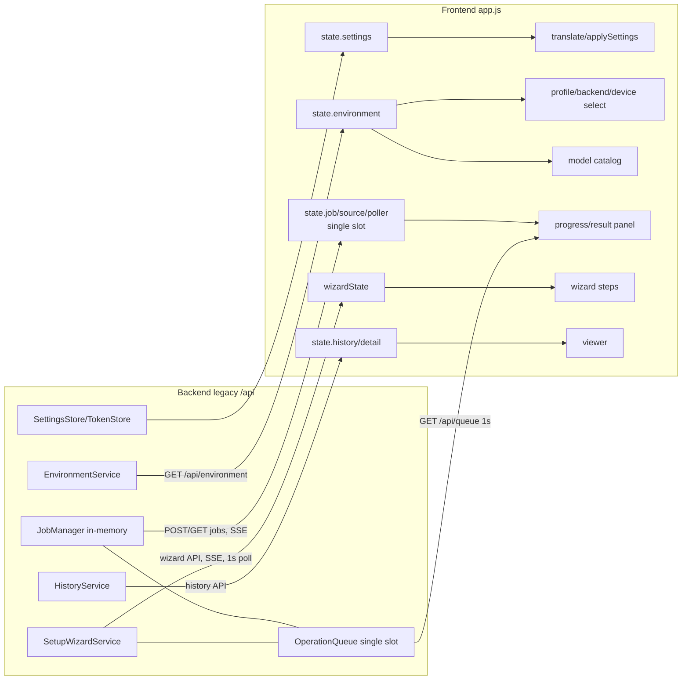

# UI-1 操作インベントリ（現行既定GUI）

更新: 2026-11-04 JST。基点 `main` = `068e62f`。行番号は`src/utteran_gui/web/app.js`（記載のないもの）。

## 対象範囲

- 画面（`index.html`の`section.view`）: `workspace` / `history` / `viewer` / `wizard` / `models` / `queue` / `settings` の7画面と共通dialog。
- 静的な操作要素: `<button>` 47、`<select>` 17、`<input>` 21、`<form>` 3、外部リンク3、`
` 2。
  動的に生成する操作: 履歴行の開く/フォルダ/削除、モデルカードのverify/削除/download、OpenVINO IR生成/削除、
  キュー行cancel、話者filter、出力形式chip、wizardのprofile radio。
- native bridge（`app.py`）: `choose_path(kind)`（file/folder dialog）、`report_frontend_error(payload)`、
  D&D（`pywebviewFullPath` → `CustomEvent("utteran-input-dropped")`）。
- 状態の持ち主: frontendは単一の可変`state`（`:42-60`）と`wizardState`（`:503-517`）。backendは
  `EnvironmentService`、`JobManager`（in-memory）、`OperationQueue`（in-memory、単一slot）、
  `SetupWizardService`、`HistoryService`（profile CLI経由のファイル）、`SettingsStore`/`TokenStore`。
- 通信: `fetch`（`api()` `:167`、cookie認証・timeoutなし）、旧SSE（`/api/jobs/{id}/events`、`/api/wizard/jobs/{id}/events`）、
  1秒polling（jobs・wizard jobs・queue）、500ms polling（model actions）。opt-in v1（B5〜B9）には**一切接続していない**。

凡例: 優先度 P1=誤った状態表示・誤投入・無反応に直結、P2=回復不能な表示/重複/不可視エラー、P3=軽微。
テスト: `static`=`tests/test_gui.py`の文字列検査、`api`=TestClientのbackend test、`repro`=UI-1ハーネス、`—`=なし。

## 1. 起動・画面切替・環境検出

| 画面/DOM ID | frontend関数 | API / bridge | 状態の持ち主 | loading/error/timeout | 描画トリガ | 重複・stale対策 | 欠陥/リスク | テスト | 優先度 |
|---|---|---|---|---|---|---|---|---|---|
| 起動 | `boot()` `:1954` | `GET /api/version` `/api/settings` `/api/environment` `/api/wizard/status` `/api/queue` | `state.settings` | `#environment-alert`に1行。timeoutなし | 各await後 | なし | R-11 | static | P2 |
| `.nav-item` | `bind()` `:1835-1843` | 画面ごとに`loadHistory`/`loadModels`/`loadQueue` | DOMの`.active` | catchなし | click | なし（連打で重複GET） | R-09 | — | P2 |
| `#profile-select` change | `loadEnvironment()` `:301` | `GET /api/environment?profile=` | `state.environment` | `#form-status`「検出中」。timeoutなし | 応答到着順 | **なし** | **D-01**、R-01 | repro | P1 |
| `#refresh-environment` | `loadEnvironment(p, true)` `:1844` | `GET /api/environment?refresh=true` | 同上 | 同上 | 同上 | なし | D-01 | repro | P1 |
| `#asr-backend` `#asr-device` `#language-select` `#diarization-*` `#show-discouraged-configurations` | `renderAsrDetail` `:399`, `renderRuntimeOptions` `:365` 等 | なし（`state.environment.options`を描画） | backendの`options`（GUIは推奨/非推奨・GenAI制限を一部判定） | — | change | — | GenAI×言語の判定（`genaiIsBlocked` `:413`）がfrontendにある | static | P2 |

## 2. 入力選択・D&D・出力先

| 画面/DOM ID | frontend関数 | API / bridge | 状態 | loading/error | 描画 | 重複/stale | 欠陥/リスク | テスト | 優先度 |
|---|---|---|---|---|---|---|---|---|---|
| `#pick-input-file` `#pick-input-folder` `#pick-output-folder` | `choosePath()` `:1626` | `pywebview.api.choose_path` | input要素の値 | bridgeなし→dialog | resolve | なし | 実機未確認 | static | P3 |
| `#input-drop-zone`（native drop） | `handleDroppedInput()` `:137` | `utteran-input-dropped`（`app.py:49-74`） | `#input-path` | 拡張子/件数をdialog | event | — | 実機未確認 | static | P3 |
| `#input-path` `#output-dir` `#recursive-input` `#include-patterns` `#exclude-patterns` | `startJob()`で読む | — | DOM値 | backendが400で検証 | — | — | — | api | P3 |

## 3. ジョブ送信・取消し・進捗・終了

| 画面/DOM ID | frontend関数 | API / bridge | 状態 | loading/error | 描画 | 重複/stale | 欠陥/リスク | テスト | 優先度 |
|---|---|---|---|---|---|---|---|---|---|
| `#job-form` submit / `#start-button` | `startJob()` `:1112` | `POST /api/jobs` → SSE `/api/jobs/{id}/events` + 1秒`GET /api/jobs/{id}` | `state.job/source/poller`（単一slot） | POST中のみdisabled。失敗はdialog | SSE・poller | POST受理後に再有効化。job IDの照合なし | **D-03**, **D-04**, R-06 | repro, static | P1 |
| 進捗 `#progress-bar` `#eta` `#stage-list` | `handleEvent()` `:992` | 旧SSE | DOM | stall表示（backend `stalled`） | event | 再接続時の重複を排除しない | **D-08**、R-07、R-10 | repro(api) | P2 |
| 終了 `#result-panel` | `finishJob()` `:1046` | `GET /api/jobs/{id}` | `state.job` | catchなし | GET後 | 終了済みガードなし | D-03, D-04 | repro, static | P1 |
| `#cancel-button` | `:1870` | `POST /api/jobs/{id}/cancel` | backend queue | POST前に「要求済み」表示 | — | disabled化のみ | **D-06** | repro | P2 |
| `#open-result` `#open-output` | `:1906-1914` | `POST /api/open-folder`、履歴API | — | catchなし | — | — | D-05同型 | — | P3 |
| 再実行 | 該当UIなし | — | — | — | — | — | 旧GUIに「再実行」操作はない（再出力のみ） | — | — |

## 4. キュー

| 画面/DOM ID | frontend関数 | API | 状態 | loading/error | 描画 | 重複/stale | 欠陥/リスク | テスト | 優先度 |
|---|---|---|---|---|---|---|---|---|---|
| `#queue-list`（1秒polling） | `loadQueue()` `:1784`, `:1976` | `GET /api/queue` | `OperationQueue`（in-memory） | 失敗は握りつぶし | 毎秒全置換 | in-flight制限なし | **D-07** | repro | P2 |
| キュー行 cancel | `queueCard()` `:1809` | `POST /api/queue/{id}/cancel` | 同上 | catchなし | 再取得 | なし | D-05同型 | — | P2 |
| `#refresh-queue` | `loadQueue` | 同上 | 同上 | catchなし | — | — | — | — | P3 |
| 順序変更・一時停止 | **なし** | 旧APIに無い（B7 v1にのみ存在、opt-in） | — | — | — | — | [backend-gap-matrix](backend-gap-matrix.md) | — | — |

## 5. モデル管理

| 画面/DOM ID | frontend関数 | API | 状態 | loading/error | 描画 | 重複/stale | 欠陥/リスク | テスト | 優先度 |
|---|---|---|---|---|---|---|---|---|---|
| モデル一覧 / `#refresh-models` | `loadModels()` `:1637` → `loadEnvironment` | `GET /api/environment` | `state.environment.models` | — | 応答後 | なし | D-01 | static | P2 |
| download / verify / remove / OpenVINO IR | `runModelAction()` `:1719` | `POST /api/models/actions` → 500ms `GET /api/wizard/jobs/{id}` | `state.modelJob` | `#models-alert` | poll | 単一実行の保証なし | R-02 | static, api | P1 |
| `#cancel-model-action` | `:1865` | `POST /api/wizard/jobs/{id}/cancel` | — | catchなし | — | — | D-05同型 | — | P2 |

## 6. Setup（旧wizard。B8 v1 Setupとは別物）

| 画面/DOM ID | frontend関数 | API | 状態 | loading/error | 描画 | 重複/stale | 欠陥/リスク | テスト | 優先度 |
|---|---|---|---|---|---|---|---|---|---|
| welcome→profile `#wizard-begin` | `wizardBegin()` `:565` | `POST /api/wizard/start`, `GET /api/wizard/hardware` | `wizardState` + backend wizard state | dialog | 成功後 | なし | — | api | P3 |
| step進行（profile/diarization/model/confirm/finish/relaunch/token-skip） | `:722`, `:729`, `:788`, `:835`, `:948`, `:954`, `:975` | `PUT /api/wizard/state` ほか | backend `wizard_state` | **catchなし** | 成功後 | なし | **D-02** | repro | P1 |
| token保存/次へ | `wizardSaveToken` `:937`, `wizardTokenNext` `:767` | `PUT/GET /api/token` | keyring/session | `#wizard-token-preflight` | — | — | — | api | P3 |
| 無人実行 | `wizardRunUnattended()` `:840`, `runWizardJob()` `:670` | `POST /api/wizard/jobs`、SSE、1秒GET、`POST /api/wizard/token-preflight` | `wizardState.running` | errorステップ（再試行あり） | poll | `running`ガードあり | R-03、D-08同型 | api | P2 |
| `#wizard-cancel` | `:983` | `POST /api/wizard/jobs/{id}/cancel` | — | catchなし | — | — | D-02同型 | — | P2 |

## 7. 結果・履歴・検索・話者名・再出力

| 画面/DOM ID | frontend関数 | API | 状態 | loading/error | 描画 | 重複/stale | 欠陥/リスク | テスト | 優先度 |
|---|---|---|---|---|---|---|---|---|---|
| 履歴一覧・filter・sort | `loadHistory()` `:1178`, `renderHistory()` `:1193` | `GET /api/history?profile=` | `state.history` | `#history-alert` | 応答後 | なし | R-04 | api, static | P2 |
| 開く `#view-viewer` | `openViewer()` `:1256` | `GET /api/history/{id}` | `state.detail` | `#viewer-error` | 応答後 | なし | R-04 | api | P2 |
| 全文検索・話者filter・時間filter | `scheduleSearch` `:1432`, `applyFiltersAndSearch` `:1389` | なし（client） | `state.viewer` | — | debounce 180ms/IME対応 | — | — | static | P3 |
| 仮想スクロール | `renderVirtualRows()` `:1450` | — | — | — | rAF | 固定行高108px | 長文行の高さ固定 | static | P3 |
| 再出力・話者名 | `regenerate()` `:1551` | `POST /api/history/{id}/regenerate` | — | `#regenerate-status` | 応答後 | disabled化あり | R-08 | api | P3 |
| 削除 | `deleteHistoryJob()` `:1594` | `DELETE /api/history/{id}` | — | alert領域 | 再取得 | confirm | R-05 | api | P2 |

## 8. 設定・ローカル保存

| 画面/DOM ID | frontend関数 | API | 状態 | loading/error | 描画 | 重複/stale | 欠陥/リスク | テスト | 優先度 |
|---|---|---|---|---|---|---|---|---|---|
| `#settings-form` | `saveSettings()` `:1817` | `PATCH /api/settings` | `SettingsStore`（GUI専用JSON） | **catchなし** | 応答後 | なし | **D-05** | repro, api | P2 |
| `#theme-select` `#ui-language` | `:1880-1891` | 保存はsubmit時 | DOM/`state.settings` | — | change即時 | — | 未保存の即時反映 | static | P3 |
| token保存/削除 | `saveToken()` `:247`, `:1892-1905` | `PUT/DELETE /api/token` | keyring / portableはsession | 保存失敗は表示、削除失敗は**表示なし** | — | — | D-05同型 | api | P2 |
| `#open-logs` | `openFolder()` | `POST /api/open-folder` | — | catchなし | — | — | D-05同型 | api | P3 |
| Preset/Policy | **なし** | B5 `/api/v1/presets`等はopt-in。旧GUI未接続 | — | — | — | — | gap | — | — |

## 9. Bridge・セキュリティ・エラー報告・SSE

| 項目 | 実装 | 所見 |
|---|---|---|
| session | `/launch?session=` → HttpOnly SameSite=Strict cookie（`api.py:267-280`）。`/api/*`はheaderかcookieを`compare_digest`（`:241-255`） | 401時、frontendは`401 Unauthorized`をそのまま表示（再launch導線なし） |
| CSP | `default-src 'self'; style-src 'self'; script-src 'self'; img-src 'self' data:; connect-src 'self'; frame-ancestors 'none'`（`api.py:261-264`） | **runtime `<style>`注入を禁止**。UIキット導入時に影響（[framework-comparison](framework-comparison.md#csp)） |
| error報告 | `window.onerror`/`unhandledrejection` → `report_frontend_error`（`:4-35`、`app.py:112`） | 操作者には見えない。D-02/D-05の失敗はここにしか出ない |
| SSE vs polling | 旧SSEは`id`付きだが`Last-Event-ID`非対応・cursor 0から再送（`api.py`）。jobs/wizardはSSE+1秒polling併用 | D-03, D-08。v1 B9は`epoch:seq`・410/`resync_required`・`/sync`を持つがGUI未接続 |
| v1 opt-in境界 | 既定`create_app(session_key, repo_root=...)`（`app.py:191`）はv1を一切mountしない | 旧queueとv1 queueは排他（v1 activate時は旧投入が409）。UI-2で混線させない |

## 主要stateの依存関係

