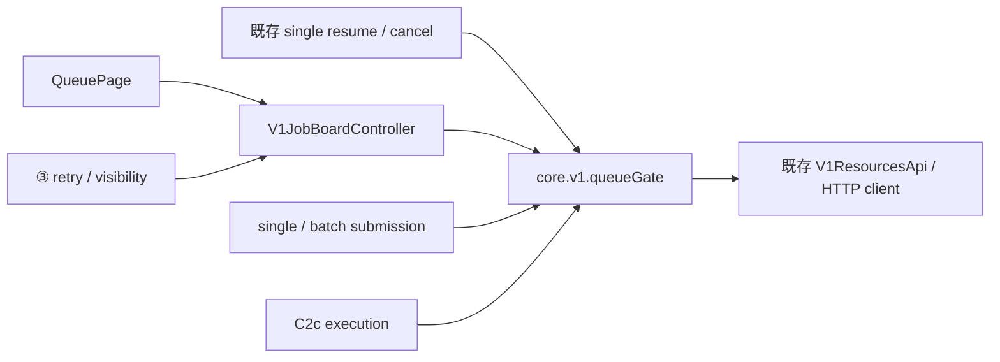

# UI-3 D2-B — Expert queue actions

2026-11-19 JST、開発版 **0.1.60（未リリース）**。基点main
`036e13ea2d612aa21f8654e426e5040bcf664d13`、main CI
[44462491950](https://github.com/zawa356/Utteran/actions/runs/44462491950) は15/15 success。
ブランチ `feat/ui3-d2b-queue-actions`。[Draft PR #67](https://github.com/zawa356/Utteran/pull/67)でownerレビュー待ち。

## 契約・基点照合

添付D2-B指示書の基点・バージョン・APIは現行mainと一致した。
AGENTSの優先順位（code、offline schema、backend正本、phase資料）と
[Design Freeze](design-freeze.md) §7を適用。backend正本やarchitecture indexの古い進捗節は
歴史記録として保持し、今回の追補から誘導する。
PUTはHTTP clientが既に対応していたため、既存mutation helperの型にのみ追加した。
公開API、DTO、schema、DB、IPC、CSP、安全境界の変更はない。

| 操作 | 既存endpoint | CAS / 対象 |
|---|---|---|
| 新規開始pause/resume | PATCH queue/control | queue revision。running workerは止めない |
| hold/unhold | PATCH queue/items/{id} | queue revision、B7が明示するqi ID、waiting Jobだけ |
| 上下1段 | PUT queue/order | queue revision、全waiting IDの完全順列 |
| 協調取消 | POST jobs/{id}/cancel | job revision、選択した内部Job、cooperativeだけ |

すべてschema_version=1、変更系queue要求はIdempotency-Keyと数値If-Matchを付ける。
保留とblockerは独立。保留解除でblockerを消さない。activeの取消要求は停止完了を意味しない。

## 操作の所有・状態

`createCore()`がv1-devだけに生成する **`core.v1.queueGate`** がアプリ全体の書込み排他の正本。
Vueのmountやpageの寿命には依存しない。

新規queue操作の要求と再照合はboard.actionとboardの凍結contextが所有する。
③のresume/cancelは既存control/context・test IDを維持し、同一ゲートを取得する。
追加のfetch clientや独立したQueuePageのmutation controllerは作らない。
取消は③の補助boardから専用ページへ移設。③からはキューページへ案内し、retry・visibility・
履歴削除の既存機能はD3まで維持する。Normalの単件取消は既存のままゲートを共有する。

- 新規intent: ゲートが空なら取得し、endpoint/method/対象、body、key、取得済みrevisionを凍結。
- pending: 二重click・別操作は拒否。成功応答は肯定的ackであり、一覧の先取り変更はしない。
- done: 応答を確認し、B7 GETで一覧・順序を再取得。GET失敗なら一覧を出さず操作を無効にする。
- conflict: 412はGETし、新しい利用者意図を待つ。新revisionでの暗黙再送はしない。
- rejected: 初回4xx（409/422/429を含む）は拒否として表示。自動再送しない。
- unknown: timeout/network/5xx/読めない2xx/ETag不一致は凍結した同じ要求を保持。
  GET、polling、モード変更、ページ離脱で成功扱い・ゲート解除しない。
  明示再照合だけが同じkey/body/If-Matchを再送する。

board unknownのdismissは無効。旧単件cancelと投入/C2cで既に存在する明示discard/reset/closeは
既存の「適用済みかもしれない」案内を維持し、該当所有者のゲートだけを解放する。
エラーは固定codeのみ。HTTP error envelopeのcodeを固定code形式で検査し、raw値を描画しない。

## 対象規則とfail closed

- 1論理行に複数の未完了枝がある場合、内部JobのID・状態・B7位置を表示し、明示selectが必要。
  最初の枝や最新枝を自動選択して書き込まない。board.currentの「B7で先に実行する枝」の意味は保持。
- holdはwaiting Jobに対応するQueueViewの明示itemのみ。active、欠落item、不明位置は拒否。
- reorderはsort=queue・query空・filter=allだけ。IME入力中のdraftも空でなければ拒否。
- waitingItemsはID、resource、positionの重複、null、不正値、active参照を検証。
  B7は削除後にordの間隔が残り得るため、positionの連続性は要求しない。
- held・setup_operationを含む全waiting itemをサーバーpositionで整列し、activeを除外。
  対象と隣接が両方Jobの場合のみ一段入替。setupを跨がず、末端で要求を送らない。
- 表示中のqueueIndex、検索結果の添字、論理行の番号からqueue IDや要求配列を生成しない。
- boardはGETとmutation ackで確認した最大queue revisionを下限として保持する。
  先取り表示をせず、ackより古いGETも拒否する。GETの失敗時は部分一覧・古い操作を出さない。
- retainWatch leaseと既存単一timerを保持。ゲートはtimerとは独立。

## 検証記録

変更前: Vitest **562 passed / 52 files**、main CI **15/15 success**。
新規typed client/board操作10件を先行追加してmainで **10 failed** を実測。
最初の試験ではjson fixture引数順の誤りも見つかったため修正し、別のmain worktreeで再実行して
10件すべてが未実装methodで失敗することを確認した。Redを合格扱いしていない。
順序のpure testsはmodule未存在でRed。追加試験は削除・skip・timeout延長でGreen化していない。
追加のack下限試験は、古いGETでもphase=doneとなることを **1 failed / 17 passed** で検出。
確認済みrevisionの下限をboardで保持する修正後にGreen、HTTP境界でも操作無効を検証した。

Green後: Vitest **590 passed / 54 files**。lint、vue-tsc、production audit（全severity 0）、
Ruff、Linux/win32 mypy、8 schema、PowerShell BOMがPASS。
全E2E・privacy・CIの最終数値とD2B-01〜16の判定はPR本文に記録する。
prototypeは **96 passed**。D2-Bは **12 passed**（分岐個別取消のHTTP/CASとcancelling表示を含む）。
ローカルNodeは22.23.5、npm 11.21.1へ揃えた（初期unit baselineだけ既設Node24/npm11.9）。
キャッシュは書込可能な一時領域を使用。

Pythonの最初の実行は31 failed / 1696 passed / 10 skipped / 1 xfailed。
この環境のtemp親ディレクトリに読取専用.git markerがあり、export先の保護が発動したことと、
既定XDG先が読取専用であることを確認。製品側の保護を緩和せず、許可された別temp先と
一時XDG先で再実行したところ **1727 passed / 1 failed / 9 skipped / 1 xfailed**。
残る既存test_devicesのprocess-tree検査は、実行ラッパーをsubreaperにして通常のinit相当の
孤児回収（waitpid）を補うと単独でPASS。製品と試験を変えず、同じ構成で全試験を再実行して
**1728 passed / 9 skipped / 1 xfailed（既存）**。skip/xfailは追加していない。

ローカル全125件の初回は **122 passed / 3 failed**。prototype全体との同時実行中に既存D1/D2Aの
polling往復2件が30秒試験時間を超過（traceを保存、固定待機中）。新規旧resume試験の1件は
起動時の実revisionより小さい固定crafted revisionが巻戻し防止で拒否されるfixture不備だった。
crafted revisionを実GETより先にし、11件のD2-Bは全件PASS。
pollingの単独再確認ではD1がPASS、D2Aは準備中の明示resumeを「無操作の画面遷移」のwriteに
数えていた既存fixtureの不備を検出。明示準備完了後を観測区間にして、遷移からのwrite 0という
元の条件を維持した。修正後の2件は **2 passed（45.3秒）**。timeoutは変更していない。
後続のローカル全125件は **124 passed / 1 failed**（D2Aの30秒timeout再発）。
単独のpolling2件はPASSだが、
全suiteの時間予算は残留リスクとして扱う。timeout延長・skipは行わない。
最終HEAD全体の126件はpush/PR CIで別途確認し、ローカル失敗を成功件数に置き換えない。

隔離コピーで安全条件を意図的に壊すmutation検証も実施。
setup横断防止を除くと1 failed、共有ゲートを無効にすると4 failed、再照合CASを最新値に
差し替えると1 failedとなり、3種とも検出した。実装worktreeには変更を残していない。

D2-Aの21件のE2E（3幅×ja/en×light/dark、長いID、IME、表のキーボード、polling lease）と、
D2-Bの実B7操作・500/network/malformed/ETag不一致・412・branch/setup安全拒否を検証。
第5案のqueue-before-cleanupと本番のreal-selected画像を目視比較。表＋右詳細、選択の強調、
検索・filter・表示ソートの構成は維持。本番は未完了行だけ、実APIの制約説明と長いIDにより
縦密度が高く、未提供stage/progressは追加しない。全12組合せで横overflowと表/詳細の重なりを検査。
D4の精密な外観一致は未達。Windows native IMEを合格とする証拠にはしない。

## 制約・次束

- D3: retry/rerun・終了行の整理・visibility移設・Viewer・再出力。今工程の未完了一覧には追加しない。
- D4/#22: Windows WebView2、DPI 125/150/200%、native D&D、実GPU、外観精密化はNOT_RUN。
- #59: 成果物削除は全OSで無効のまま。#60: retry/queue間欠は未解決、別Issueで追跡。
  既存回帰を維持し、timeout延長・skip/xfail追加は行わない。
- Ready化、main merge、force-push、tag、releaseは実施しない。
