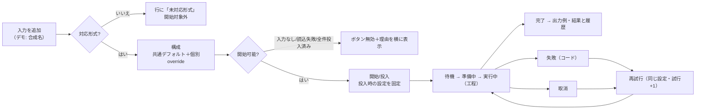
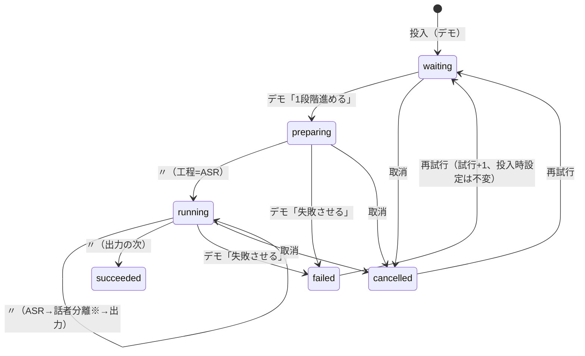

# UI-3-0 操作の状態遷移・コンポーネント分割・境界

更新: 2026-11-05 JST（0.1.43）。対象はプロトタイプ`frontend/src/preview/`。**ここに書く状態遷移は合成の表示用で、
B7のJob/Queue契約の再実装ではない。** 実装時の正本はbackend（[interfaces](../backend/interfaces.md)）。
## 0. 第5案で確定した状態遷移（§1以降の初期案より優先）

> **注:** 旧案の「再投入不可」「進捗率なし」「モデル/保存先未設計」「実行しないUI」等は当時の記録。[design-freeze.md](design-freeze.md)が確定設計の正本。`domain/demo.ts` / `domain/setup.ts`は合成状態であり本番契約ではない。

| 対象 | 第5案の挙動 | 本番への境界 |
|---|---|---|
| モード/設定 | 通常/Expertで同一state。common→override→投入時snapshotを保持 | B5契約・設定の永続化 |
| 同じ入力をもう一度追加 | 新Job ID＋現在の設定・出力先・出力名を凍結 | B7で同一入力の同時admissionを設計 |
| retry / rerun | retryは同Job/snapshot、rerunは新Job/snapshot | B7の対象状態・不変条件 |
| キューの片付け | `queueHidden`だけを変更し、結果/履歴を残す | 履歴recordと出力成果物の削除は別 |
| 出力先 | 既定→個別保存先を解決してジョブへ固定 | `FileInput.output_dir`・実パス検証 |
| 用語集 | 1行1語をまとめて編集し、検査後に適用 | B5の`asr.glossary`・OSのTXT I/O |
| セットアップ | 標準/カスタム→同意→差分plan→承認→工程→完了 | B4候補、B8 plan/journalが正本 |
| 再承認と初回主モデル | 再承認は旧ステージを再利用しない。初回成功時の主モデルを共通既定値に反映 | 本番の承認証拠とprofile/policyはbackend正本 |

## 1. 入力 → 結果の導線



## 2. ジョブの状態（合成）



※ 話者分離は投入時設定（snapshot）でオフなら飛ばす。

- **状態はレビュアーのデモ操作でだけ進む**（timerなし）。実処理や実測の進捗に見せないため。進捗率（%）は出さない（G-03）。
- 一時停止中は「すべて1段階進める」を拒否し、理由をsnackbarに出す。順序変更は待機ジョブ同士だけ。
- 一度ジョブを持った入力は再投入しない。失敗・取消は「再試行」で同じジョブを再開する。完了した入力の再実行（B7 `rerun`）は
  S3で「再実行」操作として別に設計する（プロトタイプでは提供しない）。

## 3. 設定の継承（common → override → effective → snapshot）

| 操作 | 結果 |
|---|---|
| 共通デフォルトを編集 | overrideのない項目を持つ全入力のeffective値が変わる |
| 選択ファイルで「個別に設定」をオン | 選択中の全入力へ、現在のeffective値（先頭入力の値）をoverrideとして複写。見た目の値は変わらない |
| 個別の値を編集 | 選択中の全入力のoverrideを更新 |
| 「共通に戻す」（項目）／「すべて共通に戻す」 | 選択中の入力からその項目／全項目のoverrideを削除 |
| 複数選択で値が異なる | 「複数の値」と表示。出所chipは「一部が個別」または「個別」 |
| 投入 | その時点のeffective値をjobの「投入時の設定」に固定。以後の編集は既存jobに影響しない |

継承中の項目は入力部品を**無効**にする（誤ってoverrideを作らないため）。通常モードは共通デフォルトだけを編集し、
個別設定がある入力の件数を表示する。

## 4. 表示状態（領域ごと）

| 状態 | 表示 | 部品 |
|---|---|---|
| loading | skeleton＋「読み込み中」（role=status）。開始・投入は無効、理由を表示 | `AreaState.vue`（`VSkeletonLoader`） |
| error | 領域内の`VAlert`（role=alert）＋詳細コード＋「再試行」 | `AreaState.vue` |
| empty | 次の操作を書いた案内 | `AreaState.vue` |
| ready | 本体 | slot |
| 失敗ジョブ | 行の状態chip＋同じ行に再試行／詳細に失敗コード | `JobStateChip.vue`・`JobDetail.vue` |
| 実行不可の操作 | disabled＋理由テキストを常時表示（tooltipだけにしない） | 第1案`StepStart.vue`・`StepResult.vue` → 第2案`NormalRunCard.vue` |

表示状態はレビュー操作帯の「表示状態」で切り替える。第1案: 標準／空／読み込み中／エラー／処理中／すべて完了。
**第2案（[iteration-2](iteration-2.md)）**: 1ファイル・未開始（既定）／未選択／1ファイル・実行中／失敗／完了／複数ファイル／複数ファイル・処理中／読み込み中／読み込みエラー。

## 5. コンポーネント分割

> **第2案（2026-11-05、[iteration-2](iteration-2.md)）で構成を変更した。** 下の第1案の図は履歴として残す。第2案の現行構成:
>
> ```text
> src/preview/
>   main.ts / PreviewApp.vue / PreviewShell.vue   モード別の情報設計（通常=topbar、Expert=管理sidebar）、緑テーマ切替
>   theme.ts (+ theme.test.ts)                    プロトタイプ限定の緑配色（本番theme.tsは不変）とWCAG計測
>   domain/ demo.ts fixtures.ts                   合成データ（Normal代表1件、queue/results view、架空環境の例の選択）
>           layout.ts                             LayoutController（mode・section・sidebar幅/rail・ペイン比率）＋純粋関数resolvePanes
>           envExamples.ts                        架空の実行環境例（GPU/CPU/未構成/読み込み失敗）
>           contrast.ts                           WCAGコントラスト計算
>   shell/  NormalTopNav ExpertSidebar ReviewStrip
>   normal/ NormalHome NormalFileCard NormalSettingsCard NormalRunCard useNormalFile
>   expert/ ExpertLayout InputsPane InspectorPane QueuePane
>   environment/ EnvironmentSummary ProfileCard EnvStatusChip DemoInfoChip useEnvironment
>   sections/ SetupSection QueueSection ResultsSection SettingsSection LaterSection
>   components/ ResizeHandle InputTable JobStageTrack JobStateChip JobDetail AreaState InspectorField
>               SettingsFields SyncStatus PrototypeBanner useSnapshotText
> ```
>
> 削除: `PreviewToolbar`（→`shell/ReviewStrip`）、`normal/Step*`・`NormalFlow`（→`normal/Normal*`）、`InputRow`（→`InputTable`）、
> `QueueList`・`QueueToolbar`（キュー画面の表と作業画面の要約へ分割）。最大のSFCは`ExpertLayout.vue`（約150行）。
> プロトタイプは本番`domain/shell.ts`の`ShellController`を使わなくなった（`domain/layout.ts`の`LayoutController`）。

第1案（履歴）:

```text
frontend/preview.html                 Vite dev serverだけが配信（vite buildの入力ではない）
src/preview/
  main.ts                             DEV以外では起動しない。Vuetify・theme・既存app.cssを再利用
  composables.ts                      PREVIEW注入とusePreview()（AppCoreは使わない）
  PreviewApp.vue / PreviewShell.vue   AppShell相当（app bar・サイドバー・snackbar）
  PreviewToolbar.vue                  レビュー操作帯（製品UIではない）
  domain/fixtures.ts                  決定的な合成fixture（入力・候補名・既定値）
  domain/demo.ts                      DemoController（Store、純粋関数 effectiveSettings/selectionField/stepJob）
  i18n/{ja,en,index}.ts               既存i18nと同じ方式の別辞書（本番bundleへ混ぜない）
  components/  PrototypeBanner AreaState JobStateChip InputRow InspectorField SettingsFields
               QueueList QueueToolbar JobDetail SyncStatus
  normal/      NormalFlow StepCard StepInputs StepConfig StepStart StepProgress StepResult
  expert/      ExpertLayout InputsPane InspectorPane QueuePane
  sections/    ResultsSection QueueSection SettingsSection LaterSection
```

最大のSFCは約120行（`PreviewShell.vue`）。共通部品（InspectorField・SettingsFields・QueueList・JobDetail・AreaState）は通常／Expert／キュー画面で共有する。

### 本番の層との対応（S3で差し替える箇所）

| プロトタイプ | 本番での置き換え先 | 備考 |
|---|---|---|
| `DemoController`（in-memory） | `domain/inputs.ts`・`domain/jobs.ts`（framework非依存、UI-1 §1の層） | 状態はview外に置く方式は同じ。G-05/G-06の判断までsessionのみ |
| `addFiles(n)`（合成名） | `host.pickPath()`・`host.onDroppedPaths()` | native picker/D&Dの受け口（S1/S3） |
| `submit()` | 旧`/api/jobs`（S3）→ B7 `POST /jobs`（S5、Idempotency-Key） | 202 acceptedはterminalではない |
| `stepJob`等のデモ操作 | `SingleFlightPoller`（旧`/api/queue`）／`SyncCoordinator`（v1） | 進捗%は出さない |
| `SyncStatus`の表示例 | `transport/sync`の`connected/resyncing/offline` | 実接続まで「なし」 |
| 候補名（例） | backendが返す成立候補（G-01/G-02） | frontendに互換表を持たない |
| `AreaState` | 既存`ErrorAlert.vue`＋API error分類 | コード→文言は`i18n`の`code.*` |

## 6. 隔離（本番に入らないことの担保）

| 担保 | 方法 | 検証 |
|---|---|---|
| buildに含まれない | `vite build`の入力は`index.html`だけ。`preview.html`は入力にしていない | `e2e-preview/isolation.spec.ts`: build出力のHTMLは`index.html`のみ、全assetに試作の文言・fixture名・`src/preview`が無い |
| 起動しない | `src/preview/main.ts`は`import.meta.env.DEV`以外で例外 | コードレビュー |
| backend/hostへ届かない | ESLint: `src/preview/**`から`api/` `host/` `transport/` `domain/core`等のimport、`fetch` `XMLHttpRequest` `EventSource` `WebSocket` `localStorage` `sessionStorage` `window.pywebview`を禁止 | `npm run lint`（違反を入れると失敗することを確認済み） |
| 本番から参照しない | ESLint: `src/**`（preview以外）から`preview/`のimportを禁止 | 同上 |
| 通信しない | E2E fixtureが、dev server以外のorigin・`/api`・`/next`へのrequestとconsole errorを全テストで失敗扱い | `npm run e2e:prototype` |
| 本番UI不変 | `AppShell.vue`・`App.vue`・`main.ts`・`index.html`・backendは無変更 | `npm run e2e`（UI-2既存10件） |

## 7. 日英・IME・keyboard（後続要件を含む）

- 文言は`src/preview/i18n/`（ja/en同一key・同一placeholderをVitestで検査）。英語の長い文言でもボタンは折返し、表は固定列＋ellipsis。
- keyboard: サイドバー・各ペインは文書順のTab順。入力一覧は矢印で移動しEnterで選択切替、確認dialogはEscで閉じる。
  **F6／Shift+F6でペイン間を移動**（1列表示ではペインも切り替える）。focus ringは`:focus-visible`で常に表示。
- **IME**: 第3案までは自由入力欄を置いていなかった。**第4案（owner memo #19）で`initial_prompt`と用語集を追加**し、変換中は値を確定しない・
  変換確定のEnterで語を追加しない実装と、compositionイベントを模擬したE2Eを置いた（[iteration-4 §2.4](iteration-4.md#24-ime)）。
  受入条件（compositionstart/update/end/取消、確定文字列が重複しない）の**Windows実機IMEでの受入はS3**。UI-3-0では実IMEでの動作を主張しない。

## 8. 実装済み／未実装の表示

| 区分 | 内容 |
|---|---|
| 合成データで操作可能 | 入力の追加/削除/複数選択、共通/個別設定と継承・リセット、通常/Expert切替での保持、投入、キュー操作、状態の疑似進行・失敗・再試行・取消、結果一覧への移動、表示状態・接続表示の切替、日英・テーマ、ペイン切替・F6、初期化 |
| 無効＋理由を表示 | 出力フォルダを開く、D&D、（入力なし等の）開始・投入 |
| 説明のみ（部品なし） | モデル画面 |
| 第4案で操作可能になったもの（合成） | Expertの処理設定5カテゴリ（Prompt・用語集・エンジン固有項目を含む）、プリセットの適用・管理・入出力の確認画面、セットアップウィザード（初回・追加・修復）、ログ/診断のエクスポート確認画面、緑/青テーマ。状態遷移と部品は[iteration-4 §2・§3・§7](iteration-4.md) |
| プロトタイプに無い | 実API・host bridge・永続化・出力先/batch glob/resume・結果viewer・再出力・再実行（rerun） |
