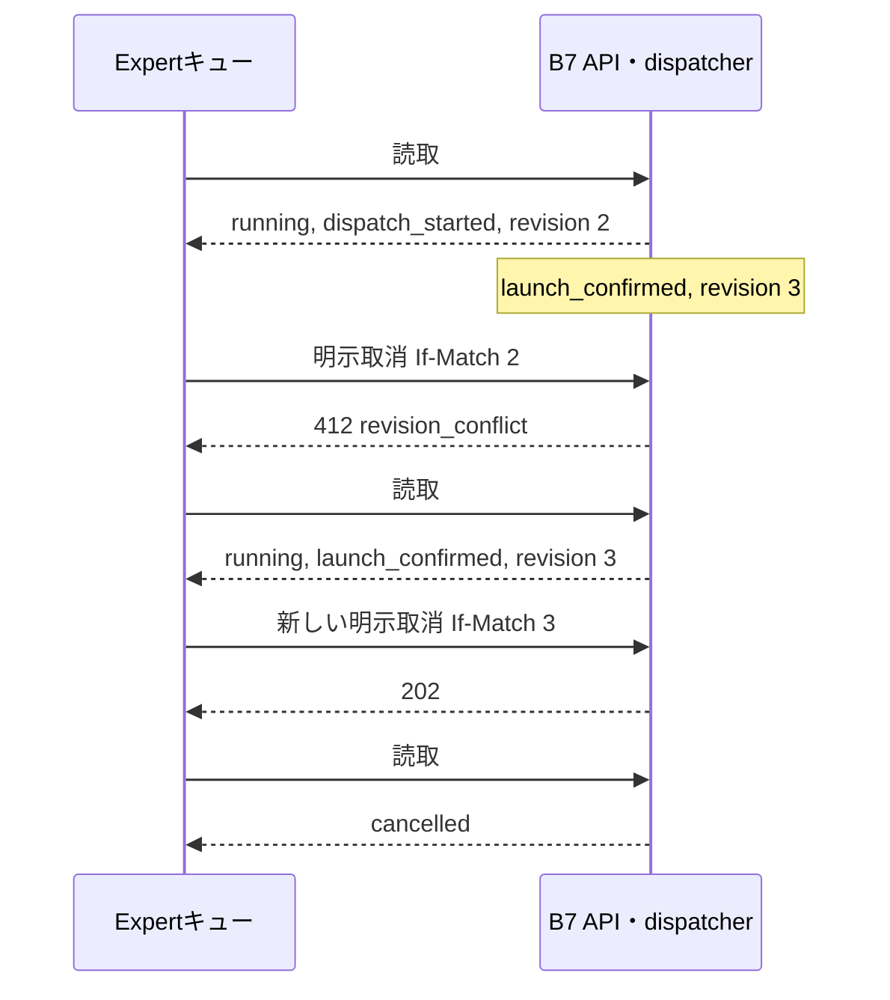

# S5-B 協調取消のCASとE2E隔離（Issue #60）

対象は開発専用 `--next-ui-v1` の合成E2E。確認基点はmain `c1fad682be4ed85cac20365771b444c2bb82a167`（0.1.61）。

## 競合と波及

過去のWindows traceでは、UIのJob revision 2読取から協調取消までの間に、実dispatcherが `launch_confirmed` を記録してrevision 3に進んだ。B7の412 `revision_conflict` で取消は成立せず、合成slow runnerが単一slotを占有したままになった。LinuxのPR #71のログにも取消の `conflict` と次試験の `queued` でのタイムアウトが残っていた。該当runではtrace artifactを取得できなかったため、その実行のrevision値は不明。Linuxの決定的合成試験で同じ順序を独立に再現した。[Issue #60](https://github.com/zawa356/Utteran/issues/60) · [PR #71のCI](https://github.com/zawa356/Utteran/actions/runs/44658837451)

## Linuxでの再現

旧E2Eの `done` 期待値だけを決定的試験に適用したRedは1件失敗（期待 `done`、実測 `conflict`）。412のHTTPと固定コード、実際の `If-Match: "2"` を先に検証してから失敗した。正しい競合処理を期待するGreenでは、明示再取消と後続Jobの完了までを検証した。

## 同期と隔離

取消成功側はExpertキューの選択中Job自身に `launch_confirmed` の理由が表示されるまで待つ。これはボタンと同じboardが取り込んだ版を確認するためのバリア。明示取消後は履歴の最終状態も確認する。CAS、冪等性、共有mutation gate、および412後の最新取得と暗黙再送なしの既存実装を維持する。

競合側では、合成runnerのみ起動確定前で待つ。先にブラウザーの取消要求が送信版を確定し、Playwrightが要求を一時保留する。その間に実dispatcherの起動を進め、公開GETでrevision 3を確認してから、その要求を実APIへ通す。製品APIへのテスト用routeやDBへの直接書き込みは不要。

S5-Bの各試験が新しい合成root、loopback listener、FastAPIプロセス、dispatcherを所有する。fixtureのteardownはstdinのEOFでサーバーを閉じ、実アプリのshutdownを経てプロセス終了を待つ。時間内に終了しない場合はそのfixtureの子プロセスだけ回収し、試験を失敗とする。S5-Aのページングは専用サーバーで105件を維持し、同じspec内のunknown試験が待機Jobを使用する。

| 試験 | 観測する条件 |
| --- | --- |
| 古いrevisionでの取消 | 2→3、実APIの412と固定コード、未取消、先頭がactive・後続が待機、暗黙再送0 |
| 明示再取消 | 最新revision 3で202、GETでcancelled、後続succeeded、active slot開放 |
| 取消せず終了した合成slow job | fixtureがプロセス終了を待機し、別試験は空のqueueから開始 |
| S5-Bのretry・順序・可視性・成果物 | 元Job不変、retry_of、既待機Jobが先、履歴の非表示／再表示、成果物検証 |
| S5-Aのページングと異常系 | 105件の永続Job、cursor横断、通信途絶時のunknownと明示解除 |
| D3-B2 | PR #71の統合時に回帰確認 |

D3-B1はBLOCKED。Windows WebView2・ネイティブpicker・DPI・実GPUは今回の合成Chromium試験の対象外。
